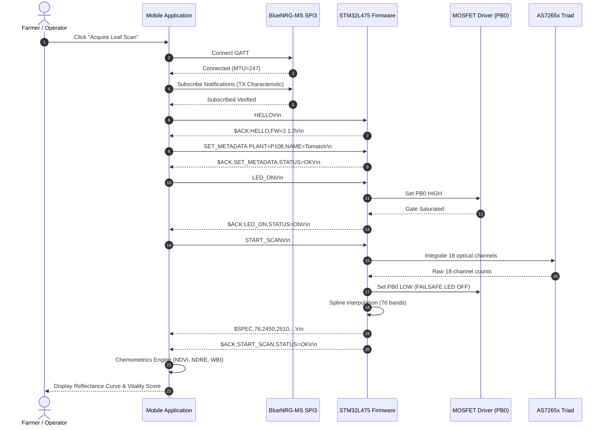

# AgriSpectra Flow & Field: STM32 Spectroscope Hardware Integration Guide

**Target Hardware:** STMicroelectronics B-L475E-IOT01A2  
**MCU:** STM32L475VGT6 (ARM Cortex-M4 @ 80 MHz, 1024 KB Flash, 128 KB SRAM)  
**Bluetooth Peripheral:** BlueNRG-MS SPI3 Transceiver (SPBTLE-RF module)  
**Optical Spectrometer:** AMS AS7265x Triad (18 Channels, 410 nm – 940 nm) on I2C2  
**Illumination Driver:** External N-Channel MOSFET Gate on PB0 (Arduino D3)  
**Mobile Integration:** Capacitor BLE (Android Native) / Web Bluetooth (PWA)  

---

## 1. System Hardware Architecture

The AgriSpectra mobile application interfaces directly with the physical handheld leaf spectroscope through Bluetooth Low Energy (BLE) or ST-Link USB Virtual COM Port.

```
+-----------------------------------------------------------------------------------+
|                            MOBILE APPLICATION (CLIENT)                            |
|  - WebBluetoothLeafClip (Manager)           - PacketChunkAccumulator (Framer)     |
|  - SpectroscopyAnalysisView (UI Studio)    - Hardware Diagnostics Dashboard       |
+----------------------------------------+------------------------------------------+
                                         | BLE GATT / USB Serial
                                         v
+-----------------------------------------------------------------------------------+
|               STMicroelectronics B-L475E-IOT01A2 SPECTROSCOPE BOARD               |
|                                                                                   |
|   +-----------------------+     SPI3      +-----------------------------------+   |
|   | BlueNRG-MS Bluetooth  |<=============>| STM32L475VGT6 Microcontroller     |   |
|   | (Custom Chat / NUS)   | (PC10-12,PD13)| - Core Clock: 80 MHz              |   |
|   +-----------------------+               | - Protocol Parser & State Engine  |   |
|                                           | - Optical Spline Engine (76-band) |   |
|   +-----------------------+     I2C2      | - LED Thermal Watchdog (15s)      |   |
|   | AS7265x Optical Triad |<=============>|                                   |   |
|   | (18-Ch Spectrometer)  | (PB10, PB11)  +-----------------+-----------------+   |
|   +-----------------------+                                 |                     |
|                                                             | PB0 (Arduino D3)    |
|   +-----------------------+                                 v                     |
|   | External Illumination |<=================== [N-Channel MOSFET Gate Driver]    |
|   | Broadband VIS-NIR LED |                                                       |
|   +-----------------------+                                                       |
+-----------------------------------------------------------------------------------+
```

---

## 2. Verified Board Pinout & Schematic Map

All GPIO and peripheral assignments correspond to the official STMicroelectronics B-L475E-IOT01A2 hardware layout:

| Peripheral | Board Pin | STM32 GPIO | Direction | Function / Configuration |
|---|---|---|---|---|
| **Illumination MOSFET Gate** | Arduino Header D3 | `PB0` | Output | Push-Pull, High Speed (Drives gate of N-Channel MOSFET) |
| **User Status LED1** | Arduino D13 | `PA5` | Output | Push-Pull, Active High (Green illumination state mirror) |
| **User Status LED2** | Onboard LED2 | `PB14` | Output | Push-Pull, Active High (System heartbeat & BLE activity) |
| **BlueNRG-MS SCK** | Internal SPI3 | `PC10` | Alternate | SPI3_SCK (Master clock) |
| **BlueNRG-MS MISO** | Internal SPI3 | `PC11` | Alternate | SPI3_MISO (Master in / Slave out) |
| **BlueNRG-MS MOSI** | Internal SPI3 | `PC12` | Alternate | SPI3_MOSI (Master out / Slave in) |
| **BlueNRG-MS CS / NSS**| Internal SPI3 | `PD13` | Output | Active Low Chip Select |
| **BlueNRG-MS IRQ** | Internal EXTI6 | `PE6` | Input | Active High Rising Edge (Interrupt from BLE module) |
| **BlueNRG-MS Reset** | Internal RST | `PA8` | Output | Active Low Hardware Reset |
| **ST-Link VCP TX** | ST-Link UART1 | `PB6` | Alternate | USART1_TX @ 115200 Baud, 8-N-1 |
| **ST-Link VCP RX** | ST-Link UART1 | `PB7` | Alternate | USART1_RX @ 115200 Baud, 8-N-1 |
| **AS7265x SCL** | Sensors I2C2 | `PB10` | Alternate | I2C2_SCL (Standard 100 kHz / Fast 400 kHz) |
| **AS7265x SDA** | Sensors I2C2 | `PB11` | Alternate | I2C2_SDA (Open-Drain with internal/external pull-ups) |

> [!CAUTION]
> **Never drive high-power illumination LEDs directly from STM32 GPIO pins.**
> The STM32L475 maximum source current per I/O pin is 20 mA. Driving an illumination LED directly from `PB0` will damage the microcontroller. An external N-Channel MOSFET (such as 2N7002, IRLML2502, or FDN337N) must be placed between `PB0` and the LED cathode with a pull-down resistor (10kΩ) to GND.

---

## 3. Bluetooth Low Energy (BLE) GATT Architecture

The application scans for advertised spectroscope devices and dynamically discovers matching GATT services. It prioritizes the ST BlueNRG Chat service and falls back to Nordic UART Service (NUS) or standard vendor profiles:

### 3.1 Supported GATT Services

1. **ST BlueNRG Chat Service (Primary):**
   - Service UUID: `00000000-000e-11e1-9ab4-0002a5d5c51b`
   - TX Characteristic (Notify / Indicate): `d973f2e1-b19e-11e2-9e96-0800200c9a66`
   - RX Characteristic (Write / Write Without Response): `d973f2e2-b19e-11e2-9e96-0800200c9a66`

2. **Nordic UART Service (NUS - Alternate):**
   - Service UUID: `6e400001-b5a3-f393-e0a9-e50e24dcca9e`
   - TX Characteristic (Notify): `6e400003-b5a3-f393-e0a9-e50e24dcca9e`
   - RX Characteristic (Write / Write Without Response): `6e400002-b5a3-f393-e0a9-e50e24dcca9e`

3. **Vendor FFE0 Service (Generic Fallback):**
   - Service UUID: `0000ffe0-0000-1000-8000-00805f9b34fb`
   - TX/RX Characteristic: `0000ffe1-0000-1000-8000-00805f9b34fb`

### 3.2 Verification & Handshake Sequence

A connection is **NEVER** marked as `CONNECTED` or `READY` merely upon transport pairing. The application enforces a strict multi-tier verification sequence:
1. GATT Connection established.
2. MTU negotiation requested (247 bytes).
3. Service discovery executed.
4. Characteristics matching `Write` and `Notify` identified.
5. Notification subscription registered and verified (`BleClient.startNotifications`).
6. Application sends `HELLO\r\n`.
7. STM32 firmware responds with `$ACK:HELLO,DEVICE=...,FW=...\r\n`.
8. State transitions to `READY`.

---

## 4. Unified Two-Way Wire Protocol Specification

All communications between the mobile application and STM32 firmware use framed ASCII lines terminated by `\r\n` (CRLF) or structured JSON.

### 4.1 Device Commands (Mobile App -> STM32)

| Command | Wire Format | Description | Expected Firmware Response |
|---|---|---|---|
| `HELLO` | `HELLO\r\n` | Protocol handshake & identity ping | `$ACK:HELLO,DEVICE=B-L475E-IOT01A2,FW=2.1.0\r\n` |
| `GET_DEVICE_INFO` | `GET_DEVICE_INFO\r\n` | Retrieve hardware & firmware build info | `$ACK:INFO,MODEL=B-L475E-IOT01A2,MCU=STM32L475...\r\n` |
| `GET_STATUS` | `GET_STATUS\r\n` | Query live LED, sensor, and battery status | `$ACK:STATUS,LED=OFF,SENSOR=OK,CALIB=LOCKED,BAT=98\r\n` |
| `LED_ON` | `LED_ON\r\n` | Actuate illumination MOSFET gate HIGH | `$ACK:LED_ON,STATUS=ON,GATE=PB0\r\n` |
| `LED_OFF` | `LED_OFF\r\n` | De-energize illumination MOSFET gate LOW | `$ACK:LED_OFF,STATUS=OFF,GATE=PB0\r\n` |
| `START_DARK_CALIBRATION` | `START_DARK_CALIBRATION\r\n` | Null electronic offset (LED OFF) | `$ACK:CALIB_DARK,STATUS=OK,OFFSET=483\r\n` |
| `START_WHITE_CALIBRATION`| `START_WHITE_CALIBRATION\r\n` | Normalize 100% PTFE standard (LED ON) | `$ACK:CALIB_WHITE,STATUS=OK,PEAK=64520\r\n` |
| `SET_PLANT_NUMBER` | `SET_PLANT_NUMBER <NUM>\r\n` | Set specimen identifier tag | `$ACK:SET_PLANT_NUMBER,<NUM>,STATUS=OK\r\n` |
| `SET_PLANT_NAME` | `SET_PLANT_NAME <NAME>\r\n` | Set crop name tag | `$ACK:SET_PLANT_NAME,<NAME>,STATUS=OK\r\n` |
| `SET_POT_NUMBER` | `SET_POT_NUMBER <POT>\r\n` | Set pot / row location tag | `$ACK:SET_POT_NUMBER,<POT>,STATUS=OK\r\n` |
| `SET_METADATA` | `SET_METADATA PLANT=...,NAME=...\r\n`| Batch set all specimen metadata | `$ACK:SET_METADATA,PLANT=...,STATUS=OK\r\n` |
| `START_SCAN` | `START_SCAN\r\n` | Execute optical scan sequence | `$SPEC,76,<counts...>\r\n` then `$ACK:START_SCAN,STATUS=OK\r\n` |
| `STOP_SCAN` | `STOP_SCAN\r\n` | Abort optical integration & force LED OFF | `$ACK:STOP_SCAN,STATUS=ABORTED\r\n` |
| `RESET_DEVICE` | `RESET_DEVICE\r\n` | Re-initialize peripheral state | `$ACK:RESET_DEVICE,STATUS=RESET_INITIATED\r\n` |

### 4.2 Error Responses (STM32 -> Mobile App)

If a command fails or violates hardware interlocks, firmware returns:
```
$ERR:<COMMAND>,REASON=<ERROR_STRING>\r\n
```
Examples:
- `$ERR:START_SCAN,REASON=UNCALIBRATED_DEVICE\r\n`
- `$ERR:LED_ON,REASON=THERMAL_WATCHDOG_INTERLOCK\r\n`
- `$ERR:CALIB_DARK,REASON=SENSOR_READ_TIMEOUT\r\n`

---

## 5. Complete 20-Step Scanning Lifecycle



---

## 6. Real Hardware Mode vs Simulation Mode

The application provides a zero-confusion operating mode architecture:
- **`REAL_HARDWARE` Mode:** Default mode. All operations communicate with the physical STM32 spectroscope. Synthetic generation (`generateSpectralSignature()`) is strictly prohibited. If communication fails or packets are missing, the app reports explicit errors.
- **`SIMULATION` Mode:** Explicitly enabled by the user or in headless automated test runners. Provides deterministic simulation for development and training.
