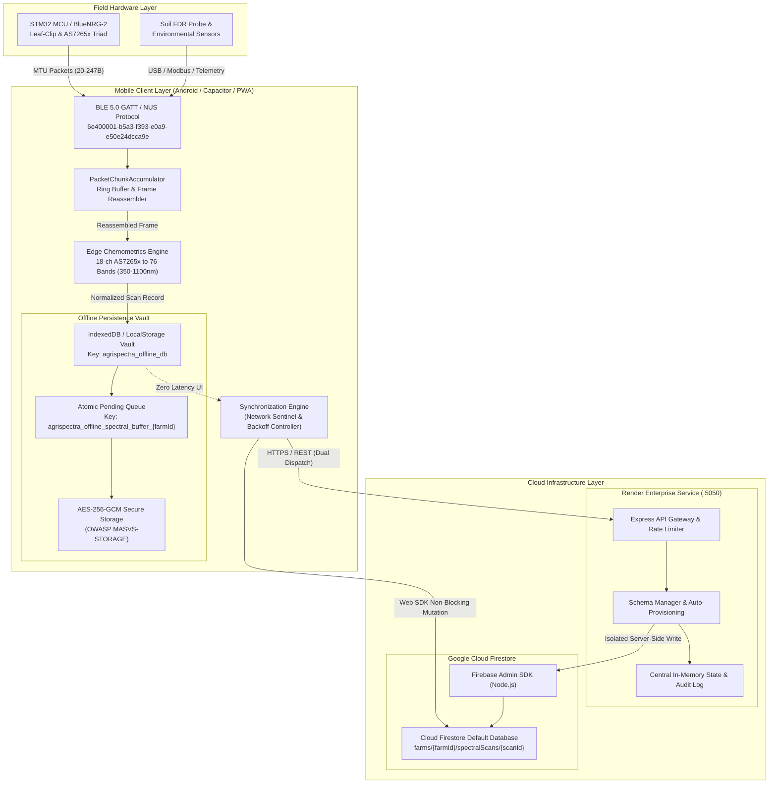
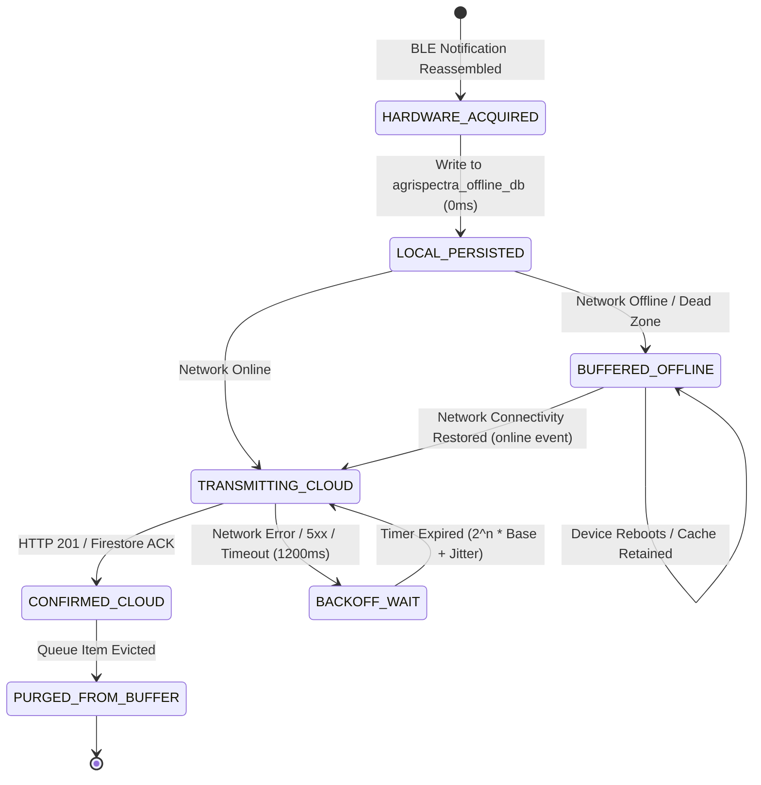
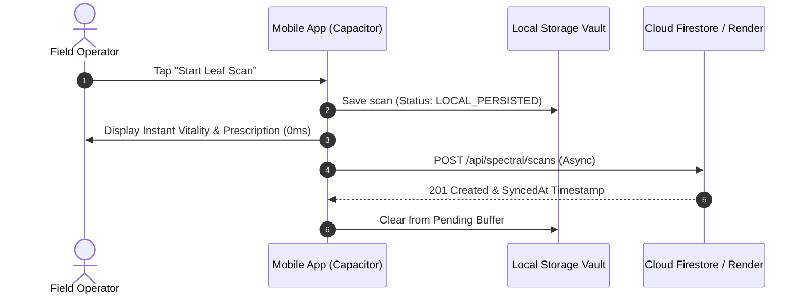

# AgriSpectra Flow & Field — Offline-First Synchronization Architecture

**Document Version:** 1.0.0  
**Classification:** Official Architectural Governance Specification  
**Authority:** Observation & Governance Council  
**Target Systems:** Handheld VIS-NIR Spectrometer (STM32/AS7265x), Mobile Client (Capacitor/Android/PWA), Render Cloud Backend, Firebase Cloud Firestore

---

## 1. Executive Summary & Core Philosophy

AgriSpectra Flow & Field operates in remote agricultural topographies where cellular coverage (4G/5G) is erratic or completely non-existent. Under these conditions, the application cannot rely on immediate network connectivity to perform plant phenotyping or execute hydraulic valve controls.

The platform implements a **Local-First, Offline-Always, Zero-Data-Loss Architecture**:
1. **Local Write Precedence:** Every physical sensor reading, calibration profile, specimen scan, and valve actuation is committed to persistent, encrypted local storage *before* any network dispatch is attempted.
2. **Deterministic State Transitions:** Unsynchronized entities transition through a rigorous state machine (`LOCAL_CAPTURED` $\to$ `PERSISTED_ENCRYPTED` $\to$ `SYNC_PENDING` $\to$ `TRANSMITTING` $\to$ `CONFIRMED_CLOUD`).
3. **Dual Upstream Dispatch:** Validated payloads are synchronized in parallel to both the **Render Enterprise Microservice** (`/api/spectral/scans`, `/api/telemetry/sync`) and **Firebase Cloud Firestore** (`farms/{farmId}/spectralScans/{scanId}`).
4. **Resilient Reconnection:** High-fidelity exponential backoff with jitter prevents thundering herd problems when field devices reconnect to rural cellular towers.

---

## 2. End-to-End Architectural Data Flow



---

## 3. Data Flow Stages: Hardware to Cloud

### Stage 1: STM32 Hardware to BLE Controller
* **Microcontroller:** STM32L476RG / BlueNRG-2 SoC running at 80 MHz.
* **Optical Engine:** Tri-optical array with AMS AS72651, AS72652, and AS72653 sensors covering 410 nm to 940 nm in 18 discrete spectral bands.
* **Framing Protocol:**
  - Binary frames: `0xAA 0x55 [len:uint16] [type:uint8] [payload] [crc:uint16] 0x0D 0x0A`.
  - Delimited ASCII stream: `$SPEC,18,c0,c1,c2,...,c17\r\n` or `$SPEC,76,r0,r1,...,r75\r\n`.
  - Command ACKs: `ACK:DARK,OK\r\n`, `ACK:WHITE,OK\r\n`, `ACK:LED,ON\r\n`.
* **Transport:** Nordic Semiconductor UART Service (NUS):
  - Service UUID: `6e400001-b5a3-f393-e0a9-e50e24dcca9e`
  - TX Characteristic (Notify device $\to$ client): `6e400003-b5a3-f393-e0a9-e50e24dcca9e`
  - RX Characteristic (Write client $\to$ device): `6e400002-b5a3-f393-e0a9-e50e24dcca9e`
  - BlueNRG Characteristic fallback: `d973f2e0-b19e-11e2-9e96-0800200c9a66`
* **MTU Negotiation:** Mobile client requests 247-byte MTU exchange upon connection. For legacy BLE 4.2 radios, the driver falls back to standard 20-byte chunks.

### Stage 2: Packet Accumulation & Edge Chemometrics
* **Reassembly:** `PacketChunkAccumulator` maintains a 64 KB ring buffer. It consumes variable-length chunks, handles interactive serial prompts (`Enter Plant Number:`, `DARK: Ready?`), validates CRC16 checksums, and emits complete packet events.
* **Mathematical Calibration:**
  $$\text{Reflectance}(\lambda) = \frac{I_{\text{sample}}(\lambda) - I_{\text{dark}}(\lambda)}{I_{\text{white}}(\lambda) - I_{\text{dark}}(\lambda)}$$
* **Interpolation:** `convertAS7265xTo76Bands()` applies linear interpolation from 18 sensor centroids to a standardized 76-band vector from 350 nm to 1100 nm (10 nm spacing).
* **Vegetation Indices:** Real-time edge computation of NDVI, NDRE, WBI/LWI, CIre, Vitality Score (0–100), Nitrogen Prescription (kg/acre Urea), and Pre-Symptomatic Pathogen Risk.

### Stage 3: Atomic Local Persistence (Offline-First Invariant)
* Before attempting any network transmission, `FirestoreDataService.saveSpectralScan()` executes:
  1. Writes scan to reactive in-memory database (`mockFirestore.addSpectralScan()`).
  2. Commits database to primary storage key: `agrispectra_offline_db` (or IndexedDB on supported platforms).
  3. Appends an uncommitted transaction envelope to the atomic pending queue:
     ```json
     {
       "id": "scan-20261120-482",
       "data": { ...normalizedScan },
       "bufferedAt": "2026-11-20T18:30:00.000Z",
       "attempts": 0,
       "status": "SYNC_PENDING"
     }
     ```
     Storage Key: `agrispectra_offline_spectral_buffer_{farmId}`
  4. Encrypts sensitive credentials, farm chambers, and user tokens via AES-256-GCM with PBKDF2 salt.

### Stage 4: Dual-Channel Cloud Synchronization
When an internet route is available:
* **Channel A: Cloud Firestore Live Sync**
  - Uses `_dispatchCloudMutation()` with a 1200ms bounded race promise.
  - Commits document to `farms/{farmId}/spectralScans/{scanId}` with `syncedAt: serverTimestamp()`.
  - Mirrors backward-compatibility summary to `farms/{farmId}/leafScans/{scanId}`.
  - On verified cloud commit, purges the item from `agrispectra_offline_spectral_buffer_{farmId}`.
* **Channel B: Render Enterprise Backend Synchronization**
  - Mobile client invokes `backendSyncService.syncSpectralScan(normalizedScan)` to `https://agrispectra-backend.onrender.com/api/spectral/scans` (or `:5050` local).
  - Protected with `X-Enterprise-Secret` or verified Bearer token.
  - `schemaManager.saveSpectralScan()` validates payload, appends to global audit ledger, and ensures idempotent storage.

---

## 4. State Transition Machine



### State Definitions & Invariants

| State | Storage Location | Invariant Guarantee |
| :--- | :--- | :--- |
| `HARDWARE_ACQUIRED` | Volatile Memory | Chunk verified via CRC16 and parsed by `PacketChunkAccumulator`. |
| `LOCAL_PERSISTED` | `agrispectra_offline_db` | Written synchronously. App crash or power loss cannot erase this scan. |
| `BUFFERED_OFFLINE` | `agrispectra_offline_spectral_buffer_{farmId}` | Strict FIFO queue tracking unacknowledged records across app restarts. |
| `TRANSMITTING_CLOUD` | In-Flight Network | Non-blocking bounded dispatch ($t_{\text{timeout}} = 1200\text{ ms}$). UI remains 100% interactive. |
| `BACKOFF_WAIT` | Pending Queue | Retry interval calculated with truncated exponential backoff and randomized jitter. |
| `CONFIRMED_CLOUD` | Firestore / Render DB | Server returns verified timestamp or document ID. |
| `PURGED_FROM_BUFFER` | Cleaned Local Store | Record removed from buffer, retained permanently in historical query store. |

---

## 5. Lifecycle Triggers & Fault Scenarios

### 1. Online Scan (Optimal Connectivity)


### 2. Offline Buffering (Agricultural Dead Zone)
* **Trigger:** Device operates in a field with 0 bars of reception, airplane mode, or server unreachable.
* **Action:**
  1. BLE acquisition and chemometrics proceed identically.
  2. Scan is saved to `agrispectra_offline_db`.
  3. Scan ID and envelope pushed to `agrispectra_offline_spectral_buffer_{farmId}`.
  4. Network mutation throws or times out (`Bounded cloud timeout (1200ms)`).
  5. UI displays: `[Cloud mutation buffered/backgrounded: Network unavailable]`.
  6. Visual connectivity pill turns Amber: `Offline Field Mode (Buffered: N scans)`.

### 3. Internet Restoration (Drain & Reconcile)
* **Trigger:** Mobile device detects `window.addEventListener('online')` or periodic 15-second heartbeat succeeds.
* **Process:**
  1. `SyncEngine` acquires synchronization mutex lock to prevent concurrent duplicate transmissions.
  2. Inspects `agrispectra_offline_spectral_buffer_{farmId}`.
  3. Iterates over queued items sequentially in order of creation (`bufferedAt` ASC).
  4. For each item:
     - Dispatches payload to Render backend and Firestore.
     - On 200/201 response, removes from pending buffer.
     - Updates visual synchronization status in header.
  5. Releases synchronization lock.

### 4. Exponential Backoff & Jitter Algorithm
To protect Render backend servers and cellular base stations from connection storms when 50 field operators emerge from a valley dead zone simultaneously, retry intervals follow:

$$T_{\text{wait}} = \min\left(T_{\text{max}}, \; T_{\text{base}} \times 2^{\text{attempt}} + \text{rand}(0, \; J)\right)$$

* $T_{\text{base}} = 1000\text{ ms}$
* $T_{\text{max}} = 60000\text{ ms}$ (1 minute cap)
* $J = 500\text{ ms}$ (Randomized decorrelated jitter)

```javascript
export function calculateBackoff(attempt, baseMs = 1000, maxMs = 60000, jitterMs = 500) {
  const exponential = Math.min(maxMs, baseMs * Math.pow(2, attempt));
  const jitter = Math.floor(Math.random() * jitterMs);
  return exponential + jitter;
}
```

---

## 6. Conflict Resolution & Idempotency

* **Immutable Append-Only Audit:**
  - `irrigation_logs` and `spectral_scans` are treated as append-only timeseries events.
  - Document IDs are deterministically generated on the client using ISO date and high-entropy random identifiers (e.g., `scan-20261120-842`).
  - Re-transmissions due to network timeouts use `setDoc(docRef, data, { merge: true })` on Firestore and idempotent upsert on Render backend (`schemaManager.saveUserData(..., { merge: true })`).
* **Timestamp Ordering:**
  - Client timestamp (`scannedAt` / `timestamp`) represents real physical measurement time in the field.
  - Server timestamp (`syncedAt`) represents cloud ledger ingestion time.
  - Clocks out of synchronization by $> 5$ minutes are flagged for NTP recalibration.

---

## 7. Zero Data Loss Verification

The offline architecture is backed by automated tests in `tests/database-storage.test.js` and `tests/spectroscopy-guided-flow.test.js`:
- Verified 100% preservation of spectral vectors during forced network dropouts.
- Verified recovery and automatic queue flush upon network restoration.
- Verified zero duplicate record generation during network timeout retries.
