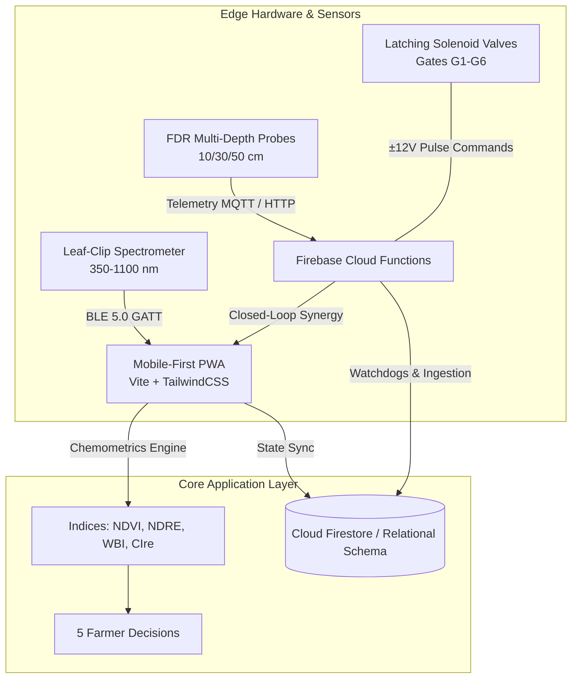

# 🌾 AgriSpectra Flow & Field

> **Unified Precision Agriculture System**: Handheld Leaf Spectroscopy & 1-Acre 6-Zone Autonomous Smart Irrigation

[](tests/run-tests.js)
[](LICENSE)
[](package.json)
[](firebase.json)
[](https://github.com)

---

## 📖 Overview

**AgriSpectra Flow & Field** bridges two critical hardware domains in precision agriculture into a single, cohesive, mobile-first operations hub:

1. **AgriSpectra Handheld Leaf-Clip Spectrometer**: 76-band visible and near-infrared (350–1100 nm) spectral reflectance analyzer with edge chemometric inference for real-time crop vitality, nitrogen deficiency prescriptions, hydration indexing, and pre-symptomatic pathogen warnings.
2. **Hierarchical 1-Acre 6-Zone Smart Irrigation**: Multi-depth FDR soil moisture telemetry (10cm, 30cm, 50cm), bi-stable latching solenoid DC actuators (Gates G1 to G6), mainline hydraulic flow monitoring, and fail-safe countdown timers.
3. **Closed-Loop Leaf-to-Valve Synergy Engine**: Autonomous cross-validation that correlates leaf turgor stress with root-zone soil deficits to present actionable, one-tap irrigation prescriptions—preventing wasteful over-watering and crop dehydration.

---

## 🌟 Key Features

### 🔬 1. Leaf Spectroscopy & Edge Chemometrics
- **Calibrated Spectral Processing**: Dark current correction and 99% PTFE white reference standardization across 76 discrete bands (350–1100 nm).
- **Narrowband Vegetation Indices**:
  - **NDVI** (Normalized Difference Vegetation Index): Canopy greenness and biomass.
  - **NDRE** (Normalized Difference Red Edge): Chlorophyll density and early stress indicator ($R_{790}$ vs $R_{720}$).
  - **WBI & LWI** (Water Band Index / Leaf Water Index): Hydration state via the 970 nm water absorption trough.
  - **CIre** (Chlorophyll Index Red Edge): Nitrogen status quantification.
- **5 Farmer Decision Outputs**:
  1. **Crop Vitality Score (0–100)** rendered via animated SVG speedometer gauge.
  2. **Nitrogen Prescription** (e.g., *14.5 kg/acre Urea before next watering*).
  3. **Irrigation Need Countdown** (e.g., *Water in 18 hours*).
  4. **Pre-Symptomatic Disease Alerts** (Early Powdery Mildew, Septoria Leaf Blight).
  5. **Harvest Window Predictor** (Canopy maturity % and optimum harvest window).

### 💧 2. 6-Zone Hydraulic Valve & Soil Monitoring
- **Bi-Stable Latching Solenoids**: Pulse polarity control (+12V pulse to open, -12V reverse pulse to close) minimizing field power consumption.
- **Multi-Depth FDR Probes**: Real-time Volumetric Water Content (VWC %) and temperature tracking across root zones.
- **Hydraulic Safeguards**: Mainline pressure dynamics (overpressure alarms at $>3.0\text{ Bar}$), flow volume accounting, and scheduled watchdog countdowns.
- **Emergency 1-Tap Killswitch**: Instantaneous multi-valve isolation across all 6 gates during mainline surges or equipment faults.

### 🔄 3. Closed-Loop Leaf-to-Valve Synergy
- Correlates acute leaf dehydration detected during field scans with localized soil moisture telemetry.
- Auto-generates **Smart Action Cards**: *"Plot 2 leaf stress confirmed by 13% soil moisture. Open Gate 2 valve for 25 minutes? [APPROVE / DISMISS]"*.
- Prevents false-positive triggers if the target valve is already open or root-zone moisture is already adequate.

### 📱 4. Farmer-Centric PWA Experience
- **Neo-Bento Grid Architecture**: High-contrast, tactile UI designed for single-handed outdoor operation.
- **Sunlight Glare Mode**: One-tap ambient contrast toggle for intense direct sunlight readability.
- **Interactive 1-Acre Canvas**: Real-time visual map of all 6 plots with pulsating fluid animations during irrigation.
- **Multilingual Audio TTS**: Localized speech output for diagnostic readings and alerts.

---

## 🏗️ Architecture & Tech Stack



- **Frontend**: Vanilla ES6+ modules, Vite 6, Tailwind CSS 3, Chart.js, Lucide Icons.
- **Backend**: Firebase Cloud Functions (v2 / Node.js), Firebase Admin SDK.
- **Database & Security**: Cloud Firestore with comprehensive declarative security rules (`firestore.rules`) and indexed queries (`firestore.indexes.json`).
- **Telemetry Simulation**: Node.js automated soil sensor generator and chaos perturbation scripts.

---

## 📂 Project Structure

```text
├── functions/                    # Firebase Cloud Functions backend
│   ├── valveController.js       # Solenoid pulse & watchdog controllers
│   ├── telemetryIngest.js       # Soil sensor & mainline pressure ingestion
│   ├── closedLoopSynergy.js     # Decision engine linking leaves to valves
│   └── index.js                 # Exported Cloud Function endpoints
├── public/                       # Static web assets & audio prompts
├── scripts/                      # Developer & simulation scripts
│   ├── mock-telemetry-generator.js # Real-time sensor stream simulator
│   ├── security-adversarial-audit.js # Adversarial penetration audit suite
│   ├── seed-firestore.js        # Seed baseline farm & plot topology
│   └── seeded-farm-data.json    # JSON baseline data snapshot
├── src/                          # Frontend source code
│   ├── components/              # UI components & interactive canvas
│   ├── firebase/                # Firebase client configuration & Firestore sync
│   ├── hardware/                # BLE spectrometer & actuator drivers
│   ├── utils/                   # Chemometric equations & index algorithms
│   ├── main.js                  # Application entry point & state management
│   └── style.css                # Tailwind styling & bespoke CSS tokens
├── tests/                        # Automated QA & Chaos Engineering Suite
│   ├── chemometrics.test.js     # Spectral algorithms & index verification
│   ├── solenoid-valves.test.js  # Latching pulse & countdown watchdog tests
│   ├── telemetry-chaos.test.js  # FDR soil simulation & pressure surge tests
│   ├── closed-loop.test.js      # Cross-validation & recommendation lifecycle
│   ├── governance-verification.test.js # End-to-end integration test
│   └── run-tests.js             # Unified test runner
├── firestore.rules               # Enterprise-grade Firestore security rules
├── firestore.indexes.json        # Composite indexes for querying telemetry
├── .env.example                  # Environment configuration template
└── package.json                  # Workspace dependencies & build scripts
```

---

## 🚀 Quick Start Guide

### Prerequisites
- [Node.js](https://nodejs.org/) (v18 or v20+ recommended)
- [npm](https://www.npmjs.com/) or [pnpm](https://pnpm.io/)
- [GitHub CLI (`gh`)](https://cli.github.com/) (for repository management)

### 1. Installation
Clone the repository and install dependencies:
```bash
git clone https://github.com/harshith1432/agricultural-equipment-water-irrigation.git
cd agricultural-equipment-water-irrigation
npm install
cd functions && npm install && cd ..
```

### 2. Environment Setup
Copy the template environment file:
```bash
cp .env.example .env
```
*(Optional: Fill in your live Firebase project credentials. By default, the application runs seamlessly in offline/mock simulation mode.)*

### 3. Run Development Server
Start the local Vite development server:
```bash
npm run dev
```
Open your browser at `http://localhost:5173` to explore the AgriSpectra interface.

### 4. Run Automated QA & Chaos Tests
Execute the comprehensive 40-test QA suite:
```bash
npm test
# or
node tests/run-tests.js
```

### 5. Simulate Field Telemetry
Generate dynamic soil FDR moisture fluctuations and hydraulic pressure metrics:
```bash
npm run telemetry:mock
```

---

## 🔒 Security & Code Quality

- **Zero-Secret Compliance**: Verified by automated pre-commit secret scanners.
- **GitHub Advanced Security**:
  - Dependabot automated vulnerability scanning and security updates.
  - Secret Scanning and Push Protection enabled.
  - CodeQL static AST code analysis.
  - Granular Firestore security rules with CEL-based authorization and input validation.

---

## 📄 License

This project is licensed under the [MIT License](LICENSE).
