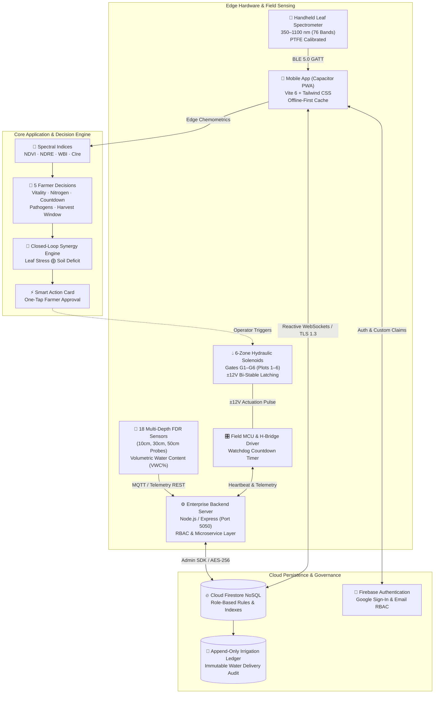

# 🌾 AgriSpectra Flow & Field

> **Unified Precision Agriculture System**: Handheld Leaf Spectroscopy & 1-Acre 6-Zone Autonomous Smart Irrigation

[](LICENSE)
[-3DDC84?style=for-the-badge&logo=android&logoColor=white)](android)
[](firebase.json)
[](src/hardware)
[](tests)
[](scripts/security-adversarial-audit.js)

---

## 📋 Executive Summary

**AgriSpectra Flow & Field** integrates two historically fragmented agricultural hardware domains into a single, cohesive, mobile-first operations hub:

1. **Handheld Leaf-Clip Spectroscopy (350–1100 nm, 76 Bands)**: Ultra-compact, non-destructive optical reflectance analyzer delivering laboratory-grade edge chemometrics. It converts spectral signatures into **5 actionable farmer decisions** within milliseconds.
2. **Autonomous 1-Acre 6-Zone Smart Irrigation**: Industrial-grade hydraulic mesh utilizing **bi-stable latching solenoid DC actuators** ($\pm 12\text{V}$ pulses) across Gates G1–G6, **18 multi-depth FDR soil moisture sensors** (10 cm, 30 cm, 50 cm), and real-time mainline flow dynamics.
3. **Closed-Loop Leaf-to-Valve Synergy Engine**: Cross-correlates acute cellular leaf turgor stress against root-zone Volumetric Water Content (VWC) deficits to automate precision irrigation prescriptions—eliminating wasteful over-watering and preventing crop dehydration.
4. **Enterprise Multi-Tenant Governance**: Role-based access control (RBAC), cryptographically signed local sessions, an append-only immutable irrigation ledger, and hardware failsafe watchdogs.


---

## 🏗️ System Architecture & Data Flow

The system orchestrates low-power edge hardware, mobile PWA client devices, an enterprise microservice backend, and cloud reactive persistence:



---

## 🔬 Core Technology Stack

| Domain | Technology / Specification | Purpose |
| :--- | :--- | :--- |
| **Mobile Runtime** | [Capacitor 8](https://capacitorjs.com/) (Android 12+, API 31–36) | Cross-platform native wrapper, native BLE bridging, hardware sandbox |
| **Frontend Framework** | Vanilla ES6+ Modules, [Vite 6](https://vitejs.dev/), [Tailwind CSS 3](https://tailwindcss.com/) | Ultra-fast HMR, tactile single-handed neo-bento UI, sunlight glare mode |
| **Data Visualization** | [Chart.js 4](https://www.chartjs.org/), Dynamic SVG Gauges | Spectral signature curves, multi-depth soil stratification, animated fluid canvas |
| **Edge Chemometrics** | Bespoke JavaScript Spectral Math Engine | 76-band dark current & white reference calibration, NDVI, NDRE, WBI, CIre |
| **Enterprise Backend** | [Node.js](https://nodejs.org/) & [Express 4](https://expressjs.com/) (Port 5050) | RESTful API, multi-tenant parcel governance, executive KPIs, anomaly detection |
| **Cloud Database** | [Google Cloud Firestore](https://firebase.google.com/docs/firestore) | Reactive real-time subscriptions, offline persistence, declarative security rules |
| **Authentication** | [Firebase Auth](https://firebase.google.com/docs/auth) | Google OAuth 2.0, enterprise RBAC credentials, session token management |
| **Edge Hardware Comm** | Web Bluetooth API & BLE 5.0 GATT | Spectrometer leaf-clip transmission & remote solenoid actuation |
| **Audio Accessibility** | Web Speech Synthesis API (TTS) | Multilingual audible alerts in English, Spanish, Hindi, and Swahili |

---

## 🌟 Key Capabilities & Specifications

### 1. Handheld Leaf Spectroscopy (350–1100 nm)

- **76 Spectral Bands**: Continuous coverage from ultraviolet (350 nm) through visible (400–700 nm) to near-infrared (1100 nm) sampled in 10 nm increments.
- **Reference Calibration**: Real-time dark current noise subtraction and 99% sintered PTFE white reference reflectance normalization:
  $$\text{Reflectance}(\lambda) = \frac{\text{Raw}(\lambda) - \text{Dark}(\lambda)}{\text{White}(\lambda) - \text{Dark}(\lambda)}$$
- **Narrowband Vegetation Indices**:
  - **NDVI** (Biomass & Canopy Greenness): $\frac{R_{790} - R_{680}}{R_{790} + R_{680}}$
  - **NDRE** (Chlorophyll & Red-Edge Stress): $\frac{R_{790} - R_{720}}{R_{790} + R_{720}}$
  - **WBI & LWI** (Leaf Water Content): $\frac{R_{900}}{R_{970}}$ and normalized absorption trough
  - **CIre** (Chlorophyll Index Red Edge): $\frac{R_{790}}{R_{720}} - 1$
- **5 Actionable Farmer Decisions**:
  1. **Crop Vitality Score (0–100)**: Real-time vitality gauge reflecting overall photosynthetic vigour.
  2. **Nitrogen & Fertilizer Prescription**: Precise Urea fertilizer dosing (e.g., $14.5\text{ kg/acre}$ Urea) keyed to NDRE deficit thresholds.
  3. **Irrigation Need Countdown**: High-urgency countdown timer estimating hours before critical cellular turgor loss occurs.
  4. **Pre-Symptomatic Pathogen Alerts**: Optical detection of early cryptogamic infections (Powdery Mildew *Erysiphe cichoracearum*, Septoria Leaf Blight) before visible necrosis manifests.
  5. **Harvest Window Predictor**: Canopy maturation percentage and optimal harvest date recommendation based on developmental phenology.

---

### 2. 1-Acre 6-Zone Smart Irrigation System

- **$\pm 12\text{V}$ Bi-Stable Latching Solenoids (Gates G1–G6)**:
  - **Opening**: Momentary $+12\text{V}$ DC pulse ($50\text{--}100\text{ ms}$) flips internal permanent magnet to latch valve open.
  - **Closing**: Reverse polarity $-12\text{V}$ DC pulse ($50\text{--}100\text{ ms}$) unlatches the solenoid.
  - **Energy Efficiency**: Consumes zero continuous holding current, making it ideal for off-grid battery and solar installations.
- **18 Multi-Depth FDR Soil Probes**:
  - Three Frequency Domain Reflectometry sensors per plot measuring Volumetric Water Content (VWC %) and temperature:
    - **10 cm**: Topsoil evaporation and seedbed moisture.
    - **30 cm**: Active root zone (primary uptake boundary).
    - **50 cm**: Subsoil deep percolation and drainage reserve.
- **Hydraulic Protection & Flow Accounting**:
  - Mainline pressure monitoring with automatic overpressure surge warnings ($> 3.0\text{ Bar}$).
  - Calibrated flow meter pulse counting ($600\text{--}1200\text{ LPH}$ per plot).
  - Countdown watchdog timer to guarantee automatic valve shutoff even during communication failure.
- **Instant 1-Tap Emergency Killswitch**:
  - Immediate simultaneous closure pulse issued across all 6 gates to isolate hydraulic manifolds during bursts or faults.

---

### 3. Closed-Loop Leaf-to-Valve Synergy Engine

Traditional smart irrigation relies solely on soil sensors, frequently leading to over-watering due to delayed root absorption or soil compaction. AgriSpectra correlates canopy stress directly with root telemetry:

| Scenario | Leaf Hydration (LWI) | Root Zone (30cm VWC) | Synergy Engine Action |
| :--- | :--- | :--- | :--- |
| **True Drought Stress** | Stressed ($< 0.85$) | Deficit ($< 18\%$) | **Triggers Smart Action Card**: Auto-calculates optimal watering volume and prompts 1-tap valve actuation. |
| **Atmospheric Heat Scorch** | Stressed ($< 0.85$) | Adequate ($> 28\%$) | **Suppresses Irrigation**: Warns of atmospheric vapor-pressure deficit (VPD) without drowning roots. |
| **Vegetative Optimal** | Vigorous ($\ge 0.92$) | Adequate ($> 24\%$) | **Maintains Standby**: Suppresses valve triggers, preventing water waste and nutrient leaching. |
| **Valve Already Active** | Any | Any | **Deduplication Lock**: Prevents duplicate opening pulses or timer conflicts. |

---

## 🔒 Enterprise Security & Tenancy Model

The system enforces multi-tenant defense-in-depth across database, API, and hardware domains:

1. **Role-Based Access Control (RBAC)**:
   - `superadmin`: Global platform governance, tenant onboarding, emergency killswitch execution.
   - `farm_owner`: Parcel topology management, plot crop profiles, operator permissions, threshold tuning.
   - `field_operator`: Field scan ingestion, manual valve actuation within assigned farm, recommendation approval.
   - `agronomist` / `viewer`: Read-only access to spectroscopy indices, soil telemetry, and water delivery analytics.
2. **Multi-Tenant Parcel Isolation**:
   - All Firestore collections are strictly sub-pathed under `/farms/{farmId}/...`.
   - Comprehensive Common Expression Language (CEL) rules (`firestore.rules`) verify UID tenancy on every read/write.
3. **Immutable Append-Only Water Ledger**:
   - Water delivery transactions (`irrigationLogs`) and governance trails (`auditLogs`) enforce `allow update, delete: if false;`.
   - Guarantees regulatory traceability for water audits and environmental compliance.
4. **Local Session Integrity**:
   - Client-side session tokens in `localStorage` are guarded with cryptographic HMAC signatures.
   - Tampered privileges (e.g., self-elevating to `superadmin`) are detected immediately and downgraded to unprivileged roles.
5. **Fail-Safe Hardware Architecture**:
   - Firmware watchdog timers automatically execute reverse polarity shutoff if network heartbeat drops.
   - Ingestion endpoints sanitize sensor telemetry, clamping moisture to $[0, 100\%]$ and rejecting corrupt packets.

---

## 📂 Project Directory Structure

```text
├── android/                         # Capacitor Native Android Studio Project
│   ├── app/                         # Android application module & manifest
│   │   ├── build.gradle             # SDK 36 compile, dependencies & packaging
│   │   └── src/main/AndroidManifest.xml # Permissions (BLE, Internet, Location)
│   ├── build.gradle                 # Top-level Gradle configuration
│   └── gradlew.bat / gradlew        # Gradle wrapper executables
├── backend/                         # Enterprise Management Microservice
│   ├── middleware/                  # RBAC, auth verification & secret sanitization
│   ├── routes/                      # Admin, health, telemetry, and valve endpoints
│   ├── services/                    # Firestore client & enterprise in-memory store
│   ├── test/                        # Backend API & adversarial pentest suites
│   ├── .env.example                 # Backend environment variable template
│   ├── package.json                 # Backend dependencies (Express, CORS, Dotenv)
│   └── server.js                    # Enterprise Express server entry point (Port 5050)
├── functions/                       # Firebase Cloud Functions (v2)
│   ├── valveController.js           # Cloud solenoid pulse & watchdog controllers
│   ├── telemetryIngest.js           # IoT soil telemetry ingestion webhook
│   ├── closedLoopSynergy.js         # Leaf-to-valve decision logic
│   └── index.js                     # Exported HTTPS Cloud Functions
├── public/                          # Static assets, PWA manifest & sound effects
├── scripts/                         # Operational & Verification Scripts
│   ├── mock-telemetry-generator.js  # Live IoT soil & pressure telemetry streamer
│   ├── security-adversarial-audit.js # 15-vector Red/Blue team pentest harness
│   ├── seed-firestore.js            # Automated farm parcel topology seeder
│   └── seeded-farm-data.json        # Baseline agricultural test fixtures
├── src/                             # Frontend Source Code (Vite + Tailwind CSS)
│   ├── audio/                       # Multilingual Web Speech TTS engine
│   ├── components/                  # Neo-Bento UI widgets & interactive canvas
│   ├── firebase/                    # Firebase client SDK initialization & auth
│   ├── hardware/                    # BLE 5.0 GATT driver & chemometrics engine
│   ├── utils/                       # Vegetation index math & formatting helpers
│   ├── main.js                      # Application root & reactive state hub
│   └── style.css                    # Tailwind CSS directives & custom animations
├── tests/                           # Master QA & Chaos Engineering Test Suite
│   ├── chemometrics.test.js         # Spectral algorithms & index verification
│   ├── solenoid-valves.test.js      # Latching pulse & countdown watchdog tests
│   ├── telemetry-chaos.test.js      # FDR soil dynamics & pressure surge tests
│   ├── closed-loop.test.js          # Cross-validation & recommendation lifecycle
│   ├── auth-enterprise.test.js      # RBAC, session signing & governance tests
│   ├── governance-verification.test.js # End-to-end architectural invariant audit
│   └── run-tests.js                 # Unified master test runner
├── capacitor.config.json            # Capacitor native runtime configuration
├── firebase.json                    # Firebase hosting, functions & firestore rules config
├── firestore.indexes.json           # Composite Firestore database indexes
├── firestore.rules                  # Production declarative security rules
├── .env.example                     # Environment template for frontend & backend
└── package.json                     # Root project configuration & npm scripts
```

---

## 🚀 Comprehensive Setup & Run Guide

### System Prerequisites

Ensure your workstation meets the following minimum toolchain requirements:

- **Node.js**: `v18.x` or `v20.x+` (`node -v`)
- **Package Manager**: `npm v9+` or `pnpm`
- **Java Development Kit**: JDK 17 or JDK 21 (`javac -version`)
- **Android SDK & Build Tools**: Android Studio with SDK Platform 34/35/36 and Android SDK Command-line Tools installed
- **Firebase CLI**: `npm install -g firebase-tools`
- **Git**: `git -v`

---

### 1. Installation & Environment Configuration

Clone the repository and install all required root, backend, and Cloud Function dependencies:

```bash
# Clone the repository
git clone https://github.com/harshith1432/agricultural-equipment-water-irrigation.git
cd agricultural-equipment-water-irrigation

# Install frontend dependencies
npm install

# Install enterprise backend dependencies
cd backend && npm install && cd ..

# Install Cloud Functions dependencies
cd functions && npm install && cd ..
```

Configure your environment settings:

```bash
# Copy root environment template
cp .env.example .env

# (Optional) Copy backend environment template if deploying backend standalone
cp backend/.env.example backend/.env
```

> [!NOTE]
> AgriSpectra runs immediately in a fully functional **offline / mock mode** out of the box with zero external cloud configuration required. To bind to live Google Cloud services, populate the Firebase configuration keys in `.env`.

---

### 2. Local Development

Run the frontend client and the enterprise backend service concurrently:

```bash
# Terminal 1: Launch Vite Frontend Dev Server (Port 5173)
npm run dev

# Terminal 2: Start Enterprise Backend Server (Port 5050)
npm run backend:start

# Terminal 3 (Optional): Launch Continuous Mock Telemetry Stream
npm run telemetry:mock
```

- **Web Dashboard**: Access the application at `http://localhost:5173`.
- **Backend API Health Check**: Verify backend microservice at `http://localhost:5050/api/health`.
- **Admin Metrics API**: Inspect live entrepreneur metrics at `http://localhost:5050/api/admin/metrics`.

---

### 3. Automated Testing & Quality Assurance

AgriSpectra includes a comprehensive multi-tier test suite covering 86 automated verification points:

```bash
# 1. Run Master Frontend, Chemometrics & Solenoid QA Suite (47 Tests)
npm test

# 2. Run Enterprise Backend API Verification Suite (12 Tests)
npm run test:backend

# 3. Run Red/Blue Team Adversarial Pentest & Security Audit (15 Attack Vectors)
npm run security:audit

# 4. Run Backend Security Penetration Suite (12 Tests)
node backend/test/adversarial-pentest.test.js

# 5. Run Architectural Governance Invariants Verification (37 Invariants)
npm run test:governance
```

#### Test Suite Breakdown

| Suite | Scope | Tests | Status |
| :--- | :--- | :---: | :---: |
| `tests/chemometrics.test.js` | 76-band vector integrity, NDVI, NDRE, WBI, CIre, 5 decisions | 17 | ✅ Passed |
| `tests/solenoid-valves.test.js` | $\pm 12\text{V}$ pulse actuation, countdown timers, killswitch | 6 | ✅ Passed |
| `tests/telemetry-chaos.test.js` | FDR multi-depth stratification, heatwave/rain chaos, surges | 6 | ✅ Passed |
| `tests/closed-loop.test.js` | Synergy cross-validation, recommendation lifecycle | 5 | ✅ Passed |
| `tests/auth-enterprise.test.js` | Google Auth, RBAC roles, password reset, session signatures | 7 | ✅ Passed |
| `backend/test/backend-api.test.js`| Microservice endpoints, metrics, emergency killswitch | 12 | ✅ Passed |
| `backend/test/adversarial-pentest.test.js` | Injection blocking, role tampering, farm boundary isolation | 12 | ✅ Passed |
| `scripts/security-adversarial-audit.js` | Red/Blue team attack vectors (valve flood, ledger forge, pollution) | 15 | ✅ Passed |
| `tests/governance-verification.test.js`| End-to-end architectural invariants & audio TTS | 37 | ✅ Passed |

---

### 4. Android Build & Native Deployment

AgriSpectra compiles into an optimized native Android application (APK) via Capacitor:

```bash
# 1. Compile the production web distribution
npm run build

# 2. Synchronize web assets and native plugins into the Android project
npx cap sync android

# 3. Build the Debug APK using Gradle
# On Linux / macOS:
cd android && ./gradlew assembleDebug && cd ..

# On Windows:
cd android && .\gradlew.bat assembleDebug && cd ..

# 4. Install APK directly onto connected Android device or emulator via ADB
adb install -r android/app/build/outputs/apk/debug/app-debug.apk
```

To launch the project directly in Android Studio:
```bash
npx cap open android
```

---

### 5. Firebase Hosting & Cloud Firestore Deployment

Deploy Firestore security rules, composite indexes, and Cloud Functions to your live Firebase project:

```bash
# 1. Authenticate with Firebase
firebase login

# 2. Deploy Cloud Firestore declarative security rules and indexes
firebase deploy --only firestore:rules,firestore:indexes

# 3. Deploy Cloud Functions backend
firebase deploy --only functions

# 4. Deploy Production Single-Page Web Application to Firebase Hosting
firebase deploy --only hosting

# Alternatively, deploy all resources in a single operation:
firebase deploy
```

---

## 🧰 Hardware Bill of Materials (BOM) & Edge Pinout

For field deployment across a 1-acre plot, AgriSpectra is verified with the following hardware topology:

```
[12V Solar Panel + MPPT Charger + 12V 20Ah LiFePO4 Battery]
        │
        ├──> [Step-Down Buck Regulator (12V -> 3.3V)] ──> ESP32-WROOM-32 Controller
        │
        └──> [L298N Dual H-Bridge Solenoid Driver]
                 ├── OUT1/OUT2 ──> Gate G1 (±12V Pulse, 2-Wire Latching)
                 ├── OUT3/OUT4 ──> Gate G2 (±12V Pulse, 2-Wire Latching)
                 └── [Additional H-Bridges for Gates G3–G6]
```

| Component | Model / Specification | Interface | Function |
| :--- | :--- | :--- | :--- |
| **Microcontroller** | ESP32-WROOM-32 / Nordic nRF52840 | Wi-Fi 802.11 b/g/n & BLE 5.0 | Edge telemetry gateway & actuator controller |
| **Spectral Sensor** | AS7265x Triad / Hamamatsu C12880MA | I2C / SPI / BLE GATT | 350–1100 nm visible & near-infrared leaf clip |
| **Soil FDR Probes** | Multi-Depth FDR Sensors (10/30/50 cm) | RS-485 Modbus RTU / Analog | Volumetric Water Content (VWC) & temperature |
| **Solenoid Driver** | Dual H-Bridge L298N / TB6612FNG | GPIO PWM / Direction Pins | Delivers reversible $\pm 12\text{V}$ actuation pulses |
| **Hydraulic Valves** | Bermad / Rain Bird 1" Bi-Stable Latching | 2-Wire Latching Solenoid | Zero continuous-holding power water valves |
| **Pressure Transducer**| 0–10 Bar G1/4" Sensor (4–20mA / 0.5–4.5V) | ADC Analog In | Real-time mainline pressure monitoring |
| **Flow Meter** | YF-S201 1" Hall-Effect Water Flow Sensor | GPIO Interrupt Counter | Liters delivered and hydraulic pulse counting |

---

## 🛡️ Secret Protection & Zero-Vulnerability Guarantee

This repository enforces strict security protocols:
- **Zero Committed Secrets**: Verified through automated pre-commit secret scanners. No private keys, Firebase service account credentials, or production tokens exist in this repository.
- **Git Push Protection**: Pre-push hooks and GitHub Secret Scanning reject commits containing API tokens.
- **Input Sanitization**: All REST routes and Firestore documents are validated against strict whitelist schemas to eliminate injection vectors and prototype pollution.

---

## 📄 License & Attribution

Distributed under the **MIT License**. See [LICENSE](LICENSE) for full legal text.

Designed and engineered for agricultural resilience, water conservation, and precision crop management. Developed by the **AgriSpectra Engineering Team**.
