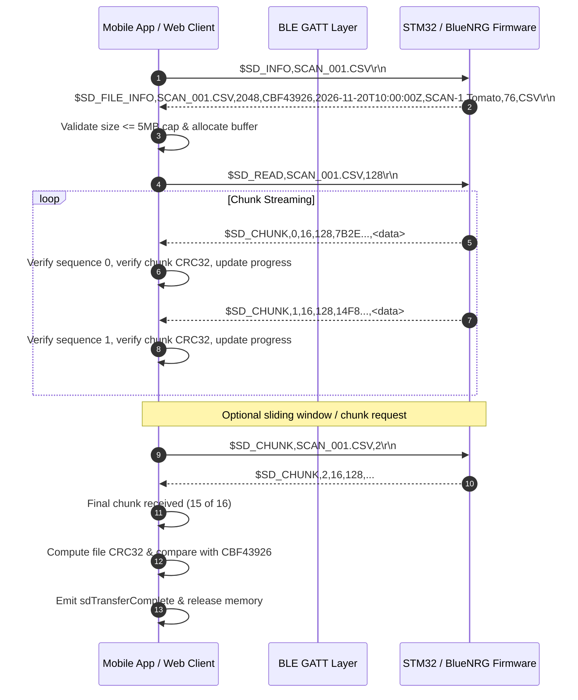
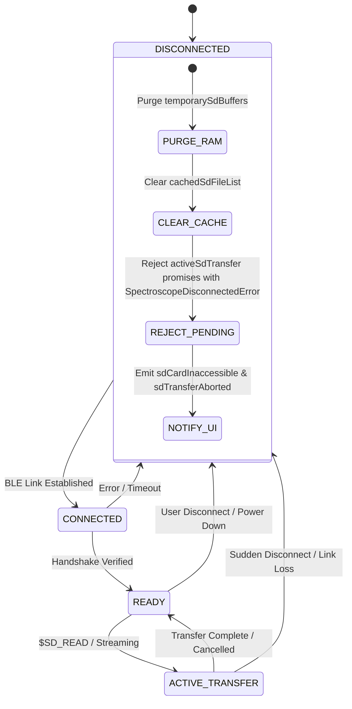

# AgriSpectra SD Card Explorer — BLE Communication Protocol & Wire Specification

**Document Version:** 1.0.0  
**Target Hardware:** STM32L475VG MCU + BlueNRG-MS BLE 5.0 Network Coprocessor + SPI MicroSD Slot  
**Operating Systems:** Android Native BLE (Capacitor) / Browser (Web Bluetooth API) / Desktop Simulation  
**Service Profiles:** Nordic UART Service (NUS) & STMicroelectronics BlueNRG Chat Service  

---

## 1. Executive Summary & Physical Architecture

The AgriSpectra Leaf-Clip Spectroscope (Clip-Pro 500) features an onboard SPI-connected MicroSD card interface running a FAT32 filesystem via the ChaN FatFs embedded library. Spectral scans (18-channel raw AS7265x sensor counts and 76-band 350–1100 nm calibrated reflectance profiles) and specimen metadata are recorded in real-time to the SD card during field expeditions.

The SD Card Explorer protocol extends the low-overhead Nordic UART Service (NUS) and ST BlueNRG GATT profiles to provide:
1. **Low-Latency File System Browsing**: Paginated, filterable directory queries with file sizes, timestamps, and specimen tags.
2. **Streaming Chunked File Transfer**: High-efficiency chunk streaming over negotiated BLE MTU (23 to 512 bytes) with end-to-end CRC32 integrity verification.
3. **Robust Flow Control & Error Resilience**: Sequence tracking, missing chunk detection, duplicate suppression, automatic retry mechanisms, and cancellation hooks.
4. **Hardware Lifecycle & Memory Isolation**: Strict connection-dependent visibility, instant memory cleanup on disconnect, and a zero-bleed in-memory simulation mode.

---

## 2. BLE GATT Topology & Transmission Characteristics

### 2.1 GATT Services and Characteristics

| Service / Characteristic | UUID | Direction | Properties | Description |
|:---|:---|:---|:---|:---|
| **Nordic UART Service (NUS)** | `6e400001-b5a3-f393-e0a9-e50e24dcca9e` | — | Primary Service | Primary direct BLE UART profile |
| **NUS RX Characteristic** | `6e400002-b5a3-f393-e0a9-e50e24dcca9e` | Client → Device | Write / Write Without Response | Client command channel |
| **NUS TX Characteristic** | `6e400003-b5a3-f393-e0a9-e50e24dcca9e` | Device → Client | Notify | Data chunks & telemetry responses |
| **BlueNRG Chat Service** | `d973f2e0-b19e-11e2-9e96-0800200c9a66` | — | Primary Service | STMicroelectronics SPBTLE-RF profile |
| **BlueNRG RX Characteristic** | `d973f2e2-b19e-11e2-9e96-0800200c9a66` | Client → Device | Write Without Response | ST coprocessor command channel |
| **BlueNRG TX Characteristic** | `d973f2e1-b19e-11e2-9e96-0800200c9a66` | Device → Client | Notify | ST coprocessor response channel |

### 2.2 MTU & Payload Sizing

- **Default ATT MTU**: 23 bytes (Effective payload: 20 bytes).
- **Negotiated Target MTU**: 247 bytes (Effective payload: 244 bytes) or 512 bytes (Effective payload: 509 bytes).
- **Command Transmission Pacing**: Transmit chunks in 20-byte sub-slices with a 20–25ms inter-packet delay when MTU negotiation is limited to 23 bytes, or full single-write writes when MTU ≥ 247 bytes.
- **Default File Chunk Size**: 128 bytes per notification chunk (optimal balance between BLE stack buffering, RAM usage on STM32 SRAM2, and transmission throughput).

---

## 3. Wire Protocol & Packet Framing

The protocol supports dual framing:
1. **Delimited ASCII Text Frames**: Human-readable, terminal-inspectable control commands and metadata responses terminated by `\r\n`.
2. **Framed Binary Packets**: High-density binary streaming format for bulk data chunks.

### 3.1 Delimited ASCII Packet Formats

#### 3.1.1 Client Commands (NUS RX)

```text
$SD_STATUS\r\n
$SD_LIST,<offset>,<limit>[,<search>][,<sort_by>][,<sort_order>]\r\n
$SD_INFO,<filename>\r\n
$SD_READ,<filename>[,<chunk_size>]\r\n
$SD_CHUNK,<filename>,<seq_num>\r\n
$SD_DELETE,<filename>\r\n
$SD_COPY,<source_file>,<destination_file>\r\n
$SD_CANCEL\r\n
$SD_DIAG\r\n
```

#### 3.1.2 Device Responses & Notifications (NUS TX)

##### 1. SD Card Status (`SD_STATUS`)
```text
$SD_STATUS,mounted=<0|1>,totalKb=<N>,usedKb=<N>,freeKb=<N>,fileCount=<N>,lastScan=<name>,health=<OK|WARN|ERR>\r\n
```
*Example:*  
`$SD_STATUS,mounted=1,totalKb=15240000,usedKb=128400,freeKb=15111600,fileCount=142,lastScan=SCAN_142.CSV,health=OK\r\n`

##### 2. Directory Listing Item (`SD_LIST_ITEM`)
```text
$SD_LIST_ITEM,<filename>,<size_bytes>,<timestamp_iso>,<scan_id>,<plant_name>,<records_count>\r\n
```
*Example:*  
`$SD_LIST_ITEM,SCAN_042.CSV,18432,2026-11-20T14:22:00Z,SCAN-9941,Roma Tomato,76\r\n`

##### 3. Directory Listing End (`SD_LIST_END`)
```text
$SD_LIST_END,<total_items>,<returned_count>\r\n
```
*Example:*  
`$SD_LIST_END,142,50\r\n`

##### 4. File Info Metadata (`SD_FILE_INFO`)
```text
$SD_FILE_INFO,<filename>,<size_bytes>,<crc32_hex>,<timestamp_iso>,<scan_id>,<plant_name>,<records_count>,<file_type>\r\n
```
*Example:*  
`$SD_FILE_INFO,SCAN_042.CSV,18432,A3B4C5D6,2026-11-20T14:22:00Z,SCAN-9941,Roma Tomato,76,CSV\r\n`

##### 5. ASCII Data Chunk (`SD_DATA_CHUNK`)
```text
$SD_CHUNK,<seq>,<total_seq>,<chunk_len>,<chunk_crc32_hex>,<hex_or_base64_payload>\r\n
```
*Example:*  
`$SD_CHUNK,0,144,128,7B2E9F10,48656164657220537065637472616C2E2E2E\r\n`

##### 6. Operation Acknowledgement (`SD_OP_ACK`)
```text
$ACK:SD_<OP>,<status>[,<key>=<value>...]\r\n
```
*Examples:*  
- `$ACK:SD_DELETE,OK,filename=SCAN_042.CSV\r\n`  
- `$ACK:SD_COPY,OK,src=SCAN_042.CSV,dest=SCAN_042_COPY.CSV\r\n`  
- `$ACK:SD_CANCEL,OK\r\n`  

##### 7. Operation Error (`SD_OP_ERR`)
```text
$ERR:SD_<OP>,<error_code>,<error_message>\r\n
```
*Examples:*  
- `$ERR:SD_DELETE,ERR_FILE_NOT_FOUND,File does not exist\r\n`  
- `$ERR:SD_READ,ERR_FILE_TOO_LARGE,File exceeds 5MB safety limit\r\n`  
- `$ERR:SD_STATUS,ERR_SD_NOT_MOUNTED,Card not inserted or SPI fault\r\n`  

##### 8. Hardware Diagnostic Report (`SD_DIAG_REPORT`)
```text
$SD_DIAG_REPORT,mounted=<0|1>,spiSpeedKhz=<N>,sdType=<SDHC|SDXC>,initStatus=<OK|ERR>,readLatencyMs=<N>,fsType=<FAT32>,sectorsPerCluster=<N>\r\n
```
*Example:*  
`$SD_DIAG_REPORT,mounted=1,spiSpeedKhz=25000,sdType=SDHC,initStatus=OK,readLatencyMs=1.2,fsType=FAT32,sectorsPerCluster=64\r\n`

---

### 3.2 Framed Binary Packet Format

For maximum transmission efficiency and minimal framing overhead, binary chunks utilize the established binary framing:

```
+------------+------------+---------------+--------------------------------------+-------------+------------+
| Magic (2B) | Total Len  | Type (1B)     | Payload (N Bytes)                    | CRC16 (2B)  | Tail (2B)  |
| 0xAA 0x55  | (uint16_t) | 0x10=SD_CHUNK | [seq:2][total_seq:2][len:2][crc32:4] | Fletcher-16 | 0x0D 0x0A  |
+------------+------------+---------------+--------------------------------------+-------------+------------+
```

- **Type Byte**: `0x10` (`PACKET_TYPES.SD_DATA_CHUNK`)
- **Binary Payload Structure**:
  - `seq` (uint16_t, Little-Endian): Current sequence index (0 to total_seq - 1).
  - `total_seq` (uint16_t, Little-Endian): Total number of chunks in file.
  - `chunk_len` (uint16_t, Little-Endian): Number of raw file bytes in this chunk.
  - `chunk_crc32` (uint32_t, Little-Endian): IEEE 802.3 CRC32 of `data_bytes`.
  - `data_bytes` (Variable, up to 128 bytes): Raw binary content slice.

---

## 4. Flow Control & Reliable Chunk Reassembly

### 4.1 Flow Control Sequence Diagram



### 4.2 Sequence Integrity & Duplicate Suppression

1. **Sequence Numbering**: Sequenced from `0` to `total_seq - 1`.
2. **Duplicate Suppression**: If sequence `k` arrives more than once (e.g. caused by BLE retry or radio re-transmission), the reassembler increments `duplicateCount` and drops the duplicate without corrupting the assembly buffer.
3. **Missing Sequence Detection**: The client maintains a bitmap/set of received sequences. If sequence `k + 1` arrives before `k`, `k` is recorded in `missingSeqs`. If `missingSeqs` remains unfulfilled for 1500ms, the client transmits `$SD_CHUNK,<filename>,<missing_seq>\r\n` to request retransmission.
4. **Retry Limit**: Maximum 3 retries per sequence. After 3 consecutive timeouts on the same chunk, the transfer fails with `ERR_TRANSFER_TIMEOUT`.

### 4.3 End-to-End Integrity Verification (CRC32)

- **Algorithm**: Standard IEEE 802.3 CRC32 (polynomial `0xEDB88320`, initial `0xFFFFFFFF`, final XOR `0xFFFFFFFF`).
- **Chunk CRC**: Validated immediately upon chunk receipt. If chunk CRC fails, the chunk is rejected and re-requested.
- **File CRC**: Once all chunks `0` through `total_seq - 1` are reassembled in RAM, the client runs `computeCrc32(assembledBuffer)`. The resulting 32-bit checksum must match the `crc32` reported in the `$SD_FILE_INFO` header.

---

## 5. Memory Safety & Security Defenses

### 5.1 Hard File Size Cap

To prevent out-of-memory crashes on mobile webviews and micro-controllers:
- **Maximum File Size**: `MAX_SD_FILE_SIZE = 5 * 1024 * 1024` (5MB).
- Any file exceeding 5MB is immediately rejected prior to transmission initiation with `ERR_FILE_TOO_LARGE`.

### 5.2 Strict Filename Sanitization & Directory Traversal Prevention

All filenames must strictly conform to:
```regexp
^[A-Za-z0-9_.\-]{1,64}$
```
- Path traversal sequences (`..`, `/`, `\`) and null bytes (`\0`) are rejected immediately with `ERR_INVALID_FILENAME`.
- Windows reserved names (`CON`, `PRN`, `AUX`, `NUL`, `COM1-9`, `LPT1-9`) are rejected.

### 5.3 RAM Buffer Lifecycle Management

- Temporary buffers are stored exclusively in an isolated `Map<filename, Uint8Array>`.
- Buffers are deallocated:
  1. Explicitly via `releaseSdCardBuffer(filename)`.
  2. When the user closes the file viewer in the UI.
  3. Immediately upon any transfer cancellation or error.
  4. Immediately upon BLE disconnect or link loss.

---

## 6. Connection-Dependent Visibility & State Cleanup

SD Card access is strictly ephemeral and tied directly to an active physical or simulated connection (`HARDWARE_STATES.READY` / `CONNECTED`).



### 6.1 Disconnect Teardown Invariants

Upon `gattserverdisconnected` or Capacitor BLE disconnect:
1. `temporarySdBuffers` is cleared immediately.
2. `cachedSdFileList` is emptied.
3. `sdCardState.mounted` is set to `false`.
4. Any active transfer promise is rejected with `SpectroscopeDisconnectedError`.
5. Event `sdCardInaccessible` is emitted to UI components to close explorers/modals.

---

## 7. High-Fidelity Simulation Fallback Specification

When operating without physical hardware (`OPERATING_MODES.SIMULATION`), the Bluetooth client emulates the SD card interface with high fidelity:

### 7.1 Virtual File Catalog

The simulated card provides 5+ realistic agricultural scan files:
1. `SCAN_001_BELL_PEPPER.CSV`: 18-channel AS7265x raw counts and 76-band spectral reflectance vector for healthy Bell Pepper canopy.
2. `SCAN_002_ROMA_TOMATO.JSON`: Complete structured JSON specimen record with chemometric indices (NDVI: 0.74, NDRE: 0.38, WBI: 0.92, Vitality: 88).
3. `SCAN_003_COTTON_LEAF.CSV`: Cotton crop canopy scan with raw counts.
4. `SCAN_004_MAIZE_STRESS.JSON`: Maize canopy experiencing water deficit (LWI: 0.84, irrigation urgency: HIGH).
5. `SCAN_005_CHILI_BLIGHT.CSV`: Early pre-symptomatic blight scan with elevated red-edge reflectance.
6. `CALIB_OPTICAL_DARK.DAT`: Baseline calibration record.

### 7.2 Strict Data Isolation Invariant

> [!IMPORTANT]
> The virtual SD card operates **exclusively in transient memory**. It **MUST NEVER** access, write to, or read from:
> - IndexedDB (`AgriSpectraSpectralDB` / `offlineSpectralDatabase`)
> - Firebase Firestore
> - Background synchronization queues (`spectralSyncEngine`)

This guarantees zero data pollution or test interference between virtual explorer sessions and official field records.

---

## 8. Summary Protocol Error Codes

| Error Code | Meaning | Recovery Action |
|:---|:---|:---|
| `ERR_SD_NOT_MOUNTED` | MicroSD card is not present or SPI initialization failed | Verify card insertion and rerun diagnostics |
| `ERR_FILE_NOT_FOUND` | Specified file does not exist on FAT32 volume | Refresh directory listing |
| `ERR_FILE_TOO_LARGE` | File exceeds 5MB safety limit | Reject download |
| `ERR_CRC_MISMATCH` | Reassembled file CRC32 differs from device CRC32 | Automatically retry transfer |
| `ERR_INVALID_FILENAME` | Filename violates naming regex or contains path traversal | Sanitize filename input |
| `ERR_TRANSFER_ABORTED` | Transfer was explicitly aborted by user | Clean up buffers |
| `ERR_TIMEOUT` | No chunk notification received within timeout window | Retry chunk or reconnect |
| `ERR_READ_ONLY` | Write/delete operation attempted on write-protected card | Toggle physical lock slider |
| `ERR_STORAGE_FULL` | Cannot write or clone file because SD card has 0 free clusters | Delete obsolete scan files |
