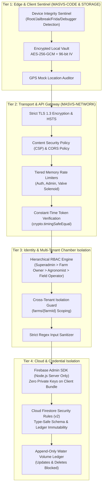

# AgriSpectra Flow & Field — Security & Governance Architecture

**Document Version:** 1.0.0  
**Classification:** Official Security & Threat Model Specification  
**Authority:** Observation & Governance Council  
**Compliance Standards:** OWASP Top 10, OWASP Mobile Top 10, OWASP MASVS-STORAGE / MASVS-NETWORK / MASVS-CODE

---

## 1. Security Architecture Overview

AgriSpectra Flow & Field controls critical physical agricultural infrastructure: **pressurized hydraulic mainlines, bi-stable 12V latching solenoid valves, and agronomic spectral decision pipelines**. A security compromise could cause hydraulic pipe rupture, water resource exhaustion, crop desiccation, or unauthorized chemical fertilization.

The security architecture enforces **Defense-in-Depth across four isolation tiers**:



---

## 2. Authentication & Authorization (RBAC)

### 1. Role-Based Access Control Hierarchy

The platform implements five strict enterprise roles with clear principle-of-least-privilege boundaries:

```
[ superadmin / admin ]
       │
       ├── Can provision/deprovision enterprise operators
       ├── Unrestricted multi-tenant access across all farm chambers (*)
       ├── Emergency hydraulic all-stop override
       └── Modify database schema and global system settings
       │
[ farm_owner ]
       │
       ├── Owns specific farm chamber (e.g., farm-valley-1)
       ├── View all 6 zones, financial metrics, and total water consumed
       ├── Create and edit crop profiles in farms/{farmId}/crops
       └── Appoint field operators and agronomists to their farm
       │
[ agronomist ]
       │
       ├── Review VIS-NIR spectroscopy scans and 76-band curves
       ├── Adjust nitrogen prescription curves and soil moisture thresholds
       └── Generate and approve closed-loop irrigation recommendations
       │
[ field_operator ]
       │
       ├── Execute latching solenoid pulse actuations (+12V open / -12V close)
       ├── Pair leaf-clip spectroscope via BLE and execute guided calibration
       ├── Record specimen metadata (plant number, port, variety)
       └── Trigger 1-tap emergency stop on assigned plots
       │
[ viewer / guest ]
       └── Read-only sandbox mode; all mutation endpoints blocked (403 Forbidden)
```

### 2. Timing-Safe Authentication & Token Verification

To eliminate **side-channel timing attacks**, the backend uses Node.js `crypto.timingSafeEqual()` for secret comparisons:

```javascript
function safeCompare(a, b) {
  if (typeof a !== 'string' || typeof b !== 'string') return false;
  const bufA = Buffer.from(a, 'utf8');
  const bufB = Buffer.from(b, 'utf8');
  if (bufA.length !== bufB.length) return false;
  return crypto.timingSafeEqual(bufA, bufB);
}
```

* **Header Credentials:**
  - `X-Enterprise-Secret`: High-privilege machine-to-machine authentication.
  - `Authorization: Bearer <token>`: Scoped JWT or session token.
* **Strict Anti-Spoofing Rule:**
  - Callers attempting to pass `X-User-Role: superadmin` without valid bearer credentials are **strictly rejected with HTTP 401 Unauthorized**.
  - Unsigned tokens attempting to claim the `superadmin` role are automatically rejected.

### 3. Multi-Tenant Farm Chamber Isolation

Each agricultural parcel operates inside a dedicated cryptographic and logical chamber:
* `farm-carlos-valley-1`: Sonoma Valley Drip Vineyard (Plots 1–6)
* `farm-elena-research-2`: Salinas Agronomy Research Hub
* `farm-mateo-hydraulic-3`: Central Valley Hydraulic Orchard
* `farm-guest-local-0`: Offline Local Sandbox

**Enforcement:**
The `verifyFarmTenantAccess` middleware intercepts every request referencing a `farmId`:
```javascript
export function verifyFarmTenantAccess(req, res, next) {
  if (!req.user) return res.status(401).json({ success: false, error: "Unauthenticated request." });

  // Superadmins possess cross-tenant access to all farm chambers
  if (req.user.role === 'superadmin' || req.user.role === 'admin') return next();

  const requestedFarmId = req.query.farmId || req.body?.farmId || req.headers['x-farm-id'];
  const userFarms = req.user.assignedFarms || [];

  if (requestedFarmId && !userFarms.includes(requestedFarmId) && !userFarms.includes('*')) {
    return res.status(403).json({
      success: false,
      error: `Cross-Tenant Access Denied: User does not have access to farm '${requestedFarmId}'.`
    });
  }
  next();
}
```

---

## 3. Render Backend API Protection & Infrastructure Isolation

### 1. Zero-Credential Client Bundle Guarantee
* **Critical Invariant:** No Google Cloud service account keys, private PEM certificates, or master database credentials ever exist in the client PWA or Android APK bundle.
* **Architecture:**
  - The client bundle contains only public configuration (`apiKey`, `projectId`, `authDomain`).
  - The backend server on Render loads `service-account.json` (or environment variable `FIREBASE_SERVICE_ACCOUNT`) inside a secure container.
  - High-privilege mutations (enterprise provisioning, emergency override, global telemetry ingestion) are performed strictly server-side via the Firebase Admin SDK.

### 2. Tiered Memory Rate Limiting Defense

To prevent denial-of-service (DoS), credential stuffing, and solenoid coil burnout, the backend employs specialized memory rate limiters:

| Limiter Target | Window | Max Requests | Purpose | Error Response |
| :--- | :---: | :---: | :--- | :--- |
| `loginLimiter` | 15 min | **10** | Prevents brute-force password attacks | HTTP 429 Anti-brute-force lockout |
| `authLimiter` | 1 min | **120** | Protects token validation & sync endpoints | HTTP 429 Auth rate limit reached |
| `adminLimiter` | 1 min | **60** | Throttles administrative queries & user updates | HTTP 429 Admin limit exceeded |
| `valveActuationLimiter` | 1 min | **15** | Protects physical latching solenoid coils from thermal burnout | HTTP 429 Hydraulic protection engaged |

### 3. Hardened HTTP Security Headers

Every response from the Render backend includes enterprise security headers:
* **Content-Security-Policy (CSP):** Restricts script, style, and connect directives. Blocks inline eval and untrusted origins.
* **Strict-Transport-Security (HSTS):** `max-age=31536000; includeSubDomains; preload` enforces TLS 1.3.
* **X-Content-Type-Options:** `nosniff` prevents MIME-type confusion attacks.
* **X-Frame-Options:** `DENY` eliminates clickjacking risks.
* **Permissions-Policy:** Explicitly disables microphone, camera (self only), and restricts geolocation to secure origins.
* **500KB Payload Cap:** Protects Node.js memory heaps against JSON bombing.

---

## 4. Hardware Integrity & Client-Side Anti-Tamper Sentinels

The mobile client runs `deviceIntegrity.js` and `secureStorage.js` to ensure the integrity of edge execution:

### 1. Root & Jailbreak Detection (OWASP MASVS-CODE)
* Probes for known root binaries and hooking artifacts: `su`, `Magisk`, `Cydia`, `Frida`.
* Probes for automated headless execution: `__nightmare`, `_phantom`, `callPhantom`.
* Probes for emulator signatures: `Android SDK built for x86`, `goldfish`, `ranchu`, `Genymotion`.
* Disables high-risk hydraulic valve actuation if high-risk threat flags are detected.

### 2. Interactive Debugger Hijacking Detection
* Executes high-frequency timing probes ($\Delta t > 100\text{ ms}$) around inline debugger probes to detect breakpoint inspection during cryptographic signing.

### 3. Mock Geolocation Detection
* Inspects `GeolocationCoordinates.isMock` (Android API 31+) and evaluates velocity plausibility. Prevents attackers from spoofing GPS coordinates to trigger valves remotely.

### 4. Authenticated Encryption at Rest (OWASP MASVS-STORAGE)
* Sensitive local tokens and cached user profiles are encrypted using **AES-256-GCM** with a 96-bit (12-byte) initialization vector (IV) generated via `crypto.getRandomValues()`.
* Generates a 128-bit authentication tag to verify ciphertext integrity before decryption.

---

## 5. Replay, Duplicate Prevention & Payload Checksums

### 1. High-Entropy Idempotency Keys
* Every leaf scan and valve actuation request carries an immutable client-generated UUID/timestamp composite key (e.g., `scan-20261120-482`, `log_1795198785356_plot-1`).
* Cloud Firestore and Render storage apply idempotent merge writes:
  - Repeated deliveries of the same payload do not create duplicate records.
  - Server timestamps are appended without corrupting the original physical scan time.

### 2. Append-Only Water Volume Ledger Invariant
* The irrigation audit collection (`farms/{farmId}/irrigationLogs/{logId}`) enforces an **append-only invariant**:
  ```javascript
  match /irrigationLogs/{logId} {
    allow read: if isFarmMember(farmId);
    allow create: if isFarmOperator(farmId) && isValidIrrigationLog(request.resource.data);
    allow update: if false; // STRICT IMMUTABILITY
    allow delete: if false; // STRICT IMMUTABILITY
  }
  ```
* Once water volume is delivered and recorded, the transaction can never be altered or erased by any user or administrator.

---

## 6. Adversarial Penetration Test Evidence

The security hardening architecture was verified against the automated red team penetration suite (`backend/test/adversarial-pentest.test.js`):

| Test Vector | Adversarial Attack Scenario | Expected Defense | Observed Result | Status |
| :---: | :--- | :--- | :--- | :---: |
| **V1** | Unauthenticated request to `/api/admin/metrics` | HTTP 401 Unauthorized | Blocked (401) | **PASS** |
| **V1** | Attacker spoofing `X-User-Role: superadmin` | HTTP 401 Unauthorized | Blocked (401) | **PASS** |
| **V1** | Attacker providing tampered `X-Enterprise-Secret` | HTTP 401 Unauthorized | Blocked (401) | **PASS** |
| **V1** | Operator role attempting admin user creation | HTTP 403 Forbidden | Forbidden (403) | **PASS** |
| **V1** | Operator attempting self-elevation to superadmin | HTTP 403 Forbidden | Blocked (403) | **PASS** |
| **V1** | Role injection containing invalid string | HTTP 400 Bad Request | Sanitizer rejection | **PASS** |
| **V2** | Password reset endpoint email flooding | Client-side rate limiter | Blocked after threshold | **PASS** |
| **V2** | User enumeration via password reset query | Generic success response | Zero user leakage | **PASS** |
| **V3** | Farm A user actuating valve on unassigned Farm B | HTTP 403 Cross-Tenant Denied | Blocked (403) | **PASS** |
| **V3** | Farm Owner querying user directory | Scoped to assigned farm | Zero cross-farm leakage | **PASS** |
| **V4** | Tampered session role in localStorage | Automatic signature mismatch downgrade | Downgraded to operator | **PASS** |
