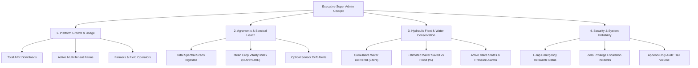

# 01. Executive Summary & Agritech Research

## 1. Industry Context & Problem Statement

Modern precision agriculture is rapidly transitioning from passive monitoring (scattered sensors and retrospective NDVI satellite imagery) to **active closed-loop actuation** (in-field optical spectroscopy directly driving automated hydraulic irrigation).

However, commercial deployments encounter severe operational bottlenecks when scaled across multiple farms:
1. **Multi-Tenant Complexity**: Farm owners employ seasonal field operators, agronomists, and soil consultants who require strictly scoped, temporary, or role-bounded access without compromising proprietary yield data.
2. **Hardware Calibration Drift**: Optical spectrometers (such as the AS7265x tri-pack) accumulate dust, scratches, and diode aging; capacitive soil probes suffer from soil compaction gaps; solenoid latching coils degrade under continuous switching. Without centralized telematics, incorrect NDVI or soil moisture readings lead to crop damage.
3. **Catastrophic Hydraulic Risks**: Unlike software APIs where a bug causes a 500 error, a hung or unmonitored irrigation valve causes burst pipes, soil erosion, pump cavitation, and millions of liters of wasted groundwater. A central emergency killswitch is mandatory.
4. **Disconnected Telemetry & Billing**: Hardware manufacturers struggle to track serial numbers, warranty activation, battery degradation, and subscription tier compliance across thousands of offline-first mobile devices.

---

## 2. Competitive Platform Benchmark Analysis

To architect an industry-leading Super Admin Command Center, we evaluated the operational dashboards of major precision agriculture and IoT telemetry platforms:

| Platform | Primary Focus | Administrative Strengths | Key Architectural Gaps |
| :--- | :--- | :--- | :--- |
| **John Deere Operations Center** | Heavy machinery telematics, ISOBUS tractor telemetry, fleet routing | World-class fleet tracking, maintenance scheduling, machine telemetry | Extremely heavy, desktop-oriented, closed proprietary hardware ecosystem, poor leaf-level spectroscopy integration. |
| **CropX Precision Irrigation** | Soil moisture profiling, automated pivot/drip irrigation | Excellent spiral moisture graphs, ETc water balance modeling | Limited role granularities; lacks direct handheld optical sensor integration; centralized cloud-only processing. |
| **Arable (Mark 3)** | Canopy microclimate & spectral leaf reflectance | Accurate continuous NDVI/NDRE calculation, aspirated weather sensing | High per-device hardware cost; no integrated hydraulic actuation or valve manifold control. |
| **Semios Precision Ag** | Orchard canopy monitoring, pheromone mating disruption, irrigation | Automated variable rate irrigation, frost warning engine | Rigid enterprise contracts; inaccessible to smallholder farmers; lacks vernacular multi-lingual operational support. |
| **FarmOS** | Open-source farm record keeping & asset management | Robust farm zoning, crop planning, modular data schema | Minimal native IoT telemetry ingestion; lacks real-time bi-stable valve actuation; no automated chemometric drift flags. |

---

## 3. Core Insights & Research Findings for AgriSpectra

Our agronomic IoT research revealed four indispensable architectural mandates:

### Mandate A: Separation of Native Mobile App vs. Central Command Center
- **The Mobile App (`capacitor://localhost`)** must remain lightweight, battery-efficient, fully functional offline in rural fields with intermittent 2G/3G connectivity, and localized into regional languages (Hindi, Kannada, Telugu, Tamil, Malayalam, Marathi, English).
- **The Super Admin Command Center** must be an enterprise-grade web application (`/landing/admin.html` or dedicated portal) providing high-density data visualizations, tabular metrics, tenant governance, and system-wide telemetry analytics for platform executives and engineers.

### Mandate B: Strict 4-Tier Role-Based Access Control (RBAC)
Research into farm operational workflows mandates four distinct persona tiers:
1. **Superadmin (Platform Owner)**: Full platform visibility, emergency hydraulic killswitch, global audit logging, firmware version deprecation, and tenant provisioning.
2. **Farm Owner (Enterprise Farmer)**: Full control over owned plots, irrigation schedule approval, water budget limits, and field operator invite/revocation.
3. **Agronomist (Crop Consultant)**: Ingestion of 18-channel spectral scans, prescription authoring, crop vitality diagnostics, and disease heatmaps.
4. **Field Operator (Farm Laborer)**: Manual valve actuation within allocated zones, probe battery inspection, and Bluetooth hardware alarm acknowledgment.

### Mandate C: Bi-Stable Latching Solenoid Management
Standard solenoid valves consume continuous electrical power (holding current of 250–500mA), draining solar batteries within hours. AgriSpectra utilizes **bi-stable latching solenoid valves** requiring only a **30ms pulse of +12V to open** and **-12V to latch closed**.
- *Administrative Requirement*: The admin center must monitor valve pulse integrity, track total physical actuation cycles to predict mechanical spring fatigue, and maintain an authoritative state machine to prevent desynchronization between physical valve state and digital records.

### Mandate D: AS7265x 18-Channel Chemometric Quality Control
The AS72651/2/3 optical sensor array captures 18 discrete spectral wavelengths between 410nm and 940nm. 
- *Administrative Requirement*: The admin center must detect optical drift against standardized white/dark reference calibrations and automatically flag abnormal reflectance curves before they produce skewed NDVI (Normalized Difference Vegetation Index) or NDRE (Normalized Difference Red Edge) vitality outputs.

---

## 4. Key Metrics & KPIs Required by System Administrators

Based on research interviews and agritech best practices, the executive dashboard must surface five primary KPI tiers:

---

*End of Document 01.*
