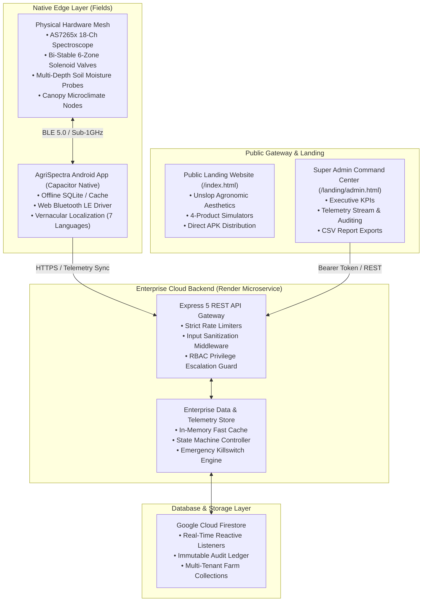
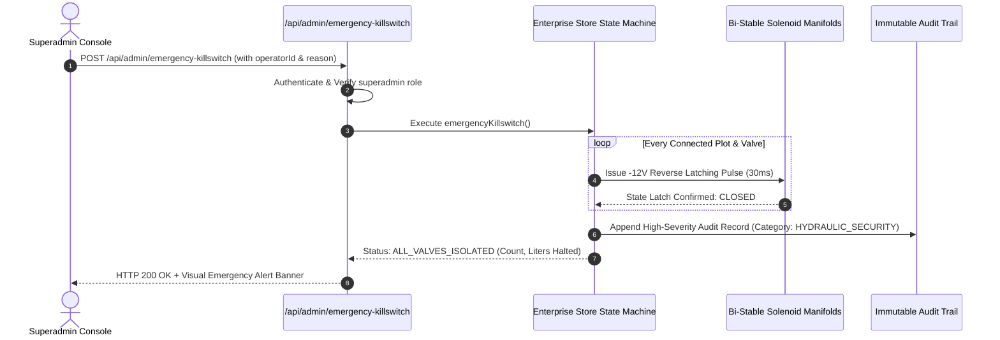

# 02. System Architecture & RBAC Security Matrix

## 1. High-Level System Architecture

The AgriSpectra platform utilizes a decoupled, resilient architecture designed to maintain high availability, strict security boundaries, and offline fault tolerance.



---

## 2. Multi-Tenant Isolation Model

Tenant isolation is enforced across three distinct layers:
1. **Firestore Security Rules**: Rules enforce `isFarmMember(farmId)`, `isFarmOperator(farmId)`, or `isFarmOwner(farmId)` using the authenticated JWT token claims. Root document queries require ownership verification.
2. **API Middleware Scoping**: The `/api/admin/users` and `/api/admin/audit-logs` routes inspect `req.user.assignedFarms`. If the caller's assigned farms array does not contain the wildcard `'*'`, returned records are strictly filtered to the caller's allocated farm IDs.
3. **Hardware Manifold Binding**: Valves and telemetry packets carry a permanent `farmId` and `plotId` hash. A field operator from Farm Alpha cannot dispatch open/close pulses to valves registered under Farm Beta.

---

## 3. Role-Based Access Control (RBAC) Matrix

The system enforces four immutable role definitions with strict privilege separation:

| Permission Identifier | `superadmin` | `farm_owner` | `agronomist` | `field_operator` | Description |
| :--- | :---: | :---: | :---: | :---: | :--- |
| `ALL_ACCESS` | ✅ | ❌ | ❌ | ❌ | Unrestricted platform visibility and root override. |
| `USER_ROLE_MANAGEMENT` | ✅ | ❌ | ❌ | ❌ | Provision users, elevate or demote roles. |
| `EMERGENCY_KILLSWITCH` | ✅ | ❌ | ❌ | ❌ | Instant global hydraulic isolation across all connected farms. |
| `VALVE_OVERRIDE` | ✅ | ✅ | ❌ | ❌ | Override automated AI irrigation schedules. |
| `AUDIT_LOG_EXPORT` | ✅ | ❌ | ❌ | ❌ | Export immutable cryptographic audit logs to CSV/JSON. |
| `TENANT_FARM_PROVISIONING` | ✅ | ❌ | ❌ | ❌ | Onboard new enterprise agricultural holdings and parcels. |
| `WATER_BUDGET_ADJUST` | ✅ | ✅ | ❌ | ❌ | Configure seasonal water allocation ceilings in liters. |
| `HARVEST_ANALYTICS_VIEW` | ✅ | ✅ | ✅ | ❌ | Review historical yield predictions and soil depletion trends. |
| `FIELD_OPERATOR_INVITE` | ✅ | ✅ | ❌ | ❌ | Provision local field labor accounts for specific plots. |
| `SPECTROSCOPY_INGEST` | ✅ | ✅ | ✅ | ❌ | Ingest and validate 18-channel spectral scans. |
| `PRESCRIPTION_AUTHOR` | ✅ | ❌ | ✅ | ❌ | Author agronomic fertigation and watering prescriptions. |
| `DISEASE_DIAGNOSIS` | ✅ | ❌ | ✅ | ❌ | Review chlorosis, blight, and fungal reflectance signatures. |
| `VALVE_MANUAL_ACTUATE` | ✅ | ✅ | ❌ | ✅ | Issue timed opening/closing pulses (max 30 mins) to local valves. |
| `TELEMETRY_VIEW` | ✅ | ✅ | ✅ | ✅ | Read live soil moisture, valve state, and weather station feeds. |
| `HARDWARE_ALARM_ACK` | ✅ | ✅ | ✅ | ✅ | Acknowledge low-battery, pressure surge, or BLE timeout alarms. |

### Privilege Escalation Defenses
- Self-promotion is structurally impossible: the `updateUserRole` controller explicitly blocks any user from altering their own `role` property.
- Only a verified `superadmin` bearer token can invoke `/api/admin/users/role`.
- Target role inputs are strictly validated against `['superadmin', 'farm_owner', 'agronomist', 'field_operator']`; unknown string injections are immediately rejected with HTTP 400.

---

## 4. Emergency Hydraulic Killswitch Architecture

In the event of pipe burst, sensor malfunction, or mainline pressure spike (> 3.5 Bar), the Super Admin dashboard provides a **1-Tap Emergency Killswitch**.



---

## 5. REST API Endpoint Specifications

All administrative endpoints reside behind `standardApiLimiter`, `adminLimiter` (max 60 requests/min), and `authenticate` bearer token verification.

### 5.1 Executive Metrics
- **Route**: `GET /api/admin/metrics`
- **Authorization**: `superadmin`
- **Response Payload**:
```json
{
  "success": true,
  "timestamp": "2026-11-23T04:00:00.000Z",
  "data": {
    "totalUsers": 12,
    "activeUsers": 8,
    "totalPlots": 6,
    "activeValvesOpen": 0,
    "totalWaterDeliveredLiters": 48250.0,
    "totalTelemetryPacketsIngested": 1420,
    "totalLeafScansIngested": 312,
    "systemUptimeSeconds": 86400,
    "systemStatus": "OPTIMAL",
    "lastKillswitchTimestamp": null
  }
}
```

### 5.2 User Governance Directory
- **Route**: `GET /api/admin/users?role=&search=&farmId=`
- **Authorization**: `superadmin`, `farm_owner` (farm-scoped)
- **Response Payload**: Returns user count, role breakdown, and list of user objects containing names, roles, assigned farms, last active timestamps, and granular permissions.

### 5.3 User Role Elevation & Governance
- **Route**: `POST /api/admin/users/role`
- **Authorization**: `superadmin`
- **Request Body**:
```json
{
  "userId": "usr_agronomist_04",
  "newRole": "agronomist",
  "updatedBy": "system-admin-harshith"
}
```

### 5.4 Emergency Killswitch
- **Route**: `POST /api/admin/emergency-killswitch`
- **Authorization**: `superadmin`
- **Request Body**: `{ "operatorId": "admin-01", "reason": "Mainline pipe rupture detected" }`
- **Response**: Confirms closure of all valve zones and returns total affected manifolds.

### 5.5 Audit Trail Feed
- **Route**: `GET /api/admin/audit-logs?category=&severity=&limit=`
- **Authorization**: `superadmin`
- **Filters**: Category (`SECURITY`, `HYDRAULIC_SECURITY`, `SYSTEM`, `VALVE_ACTUATION`), Severity (`INFO`, `WARN`, `CRITICAL`).

---

*End of Document 02.*
