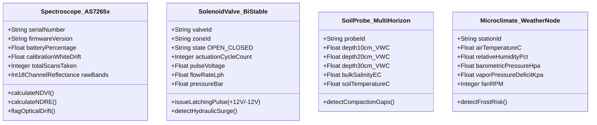
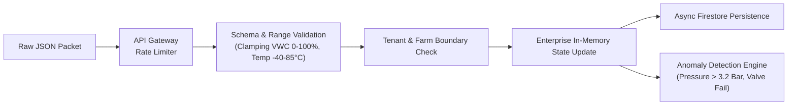

# 03. Hardware Fleet Telematics & Calibration Architecture

## 1. The Four-Product Hardware Suite

The AgriSpectra ecosystem interfaces with four physical hardware instruments. The Super Admin Command Center must monitor the health, calibration posture, firmware version, and communication fidelity of each device line.



---

## 2. Product Specifications & Telematics Models

### Product 1: Handheld AS7265x 18-Channel Leaf Spectroscope
- **Hardware Architecture**: 3-sensor optical cluster (AS72651 NIR, AS72652 Color Visible, AS72653 UV/Blue).
- **Wavelength Coverage**: 18 discrete spectral bands from 410 nm to 940 nm with 20 nm full-width at half-maximum (FWHM).
- **Communication**: BLE 5.0 (Nordic nRF52840 SoC) with offline MicroSD FAT32 logging fallback.
- **Admin Fleet Telematics Monitored**:
  - *Battery Degradation*: LiPo voltage curve, charge cycles, thermal state during high-current LED flashes.
  - *Optical Calibration Drift*: Comparison against factory calibration white reference tiles (Spectralon 99%). If raw counts drift > 5.5% across reference sweeps, the admin panel flags the device for recalibration.
  - *Photodiode Saturation*: Flags ambient sunlight leakage (when the leaf clamp optical gasket is degraded or improperly seated).

### Product 2: Bi-Stable Solenoid Drip Irrigation Valve
- **Operating Mechanism**: 2-way bi-stable latching pulse solenoid. Uses an internal permanent magnet to hold the plunger in either OPEN or CLOSED state indefinitely without continuous current.
- **Actuation Pulse**: Requires a momentary 30ms DC pulse of **+12V (250mA)** to open and a reverse polarity pulse of **-12V (250mA)** to latch closed.
- **Hydraulic Operating Range**: 0.5 Bar to 10 Bar (7 to 145 PSI), 1" BSP/NPT female threads.
- **Admin Fleet Telematics Monitored**:
  - *Coil Resistance & Pulse Integrity*: Sensed back-EMF verifying that the physical plunger traversed its full stroke.
  - *Actuation Cycle Counter*: Mechanical diaphragm and return spring life expectancy rated for 100,000 pulses; admin alerts trigger at 80,000 cycles.
  - *Pressure Transducer Integration*: Immediate detection of upstream water hammer or downstream flow blockage.

### Product 3: Multi-Depth FDR Capacitance Soil Moisture Probe
- **Technology**: 100 MHz Frequency Domain Reflectometry (FDR) with 316L stainless steel sensor rings.
- **Sensing Horizons**: Multi-horizon profiling at 10 cm (surface evaporation), 20 cm (active root uptake), and 30 cm (deep percolation boundary).
- **Measurement Envelope**: 0 to 100% Volumetric Water Content (VWC) with ±2% accuracy; bulk electrical conductivity (EC) 0 to 20 mS/cm; temperature -20°C to +60°C.
- **Admin Fleet Telematics Monitored**:
  - *Compaction & Soil Cavitation*: Flags anomalies where shallow sensors read drier than deep horizons despite recent irrigation events.
  - *Salinity Creep*: Accumulation of fertilizer salts (EC > 3.5 mS/cm) triggering root zone flush alerts.
  - *Solar Battery Autonomy*: Solar harvest current (mA) and supercapacitor/LiFePO4 voltage.

### Product 4: Aspirated Canopy Microclimate Station
- **Sensor Suite**: SHT35 precision digital humidity & temperature sensor (±0.2°C, ±1.5% RH), Bosch BMP390 barometric altimeter, and aspirated solar radiation shield with continuous DC micro-fan.
- **Agronomic Calculations**: Real-time Vapor Pressure Deficit (VPD in kPa), Dew Point, and cumulative Growing Degree Days (GDD).
- **Admin Fleet Telematics Monitored**:
  - *Fan Aspiration RPM*: Detects insect/debris clogging of the aspiration fan; flags stagnant temperature readings during direct solar noon.
  - *Frost & Heat Stress Prediction*: Early-warning alerts dispatched when dew point and temperature trajectory predict freezing within 90 minutes.

---

## 3. Telemetry Ingestion Pipeline & Schemas

Field telemetry is streamed via the mobile app gateway using `/api/telemetry/sync` and `/api/platform/events`.

### Ingestion Validation Pipeline


### Standardized Telemetry Packet Schema
```json
{
  "timestamp": "2026-11-23T04:12:00.000Z",
  "farmId": "farm-valley-1",
  "plotId": "plot-1",
  "zoneId": "G1",
  "deviceId": "ESP32-SOLENOID-8F4A",
  "valveState": "CLOSED",
  "mainlinePressureBar": 2.45,
  "flowRateLph": 0.0,
  "soilSensors": {
    "depth10cm": { "vwc": 19.2, "temperatureC": 22.8, "ec": 1.12 },
    "depth20cm": { "vwc": 21.5, "temperatureC": 21.1, "ec": 1.05 },
    "depth30cm": { "vwc": 24.1, "temperatureC": 19.5, "ec": 0.98 }
  },
  "microclimate": {
    "airTempC": 26.4,
    "relativeHumidityPct": 58.2,
    "vpdKpa": 1.42,
    "fanRpm": 3200
  },
  "batteryMv": 3890,
  "rssiDbm": -68
}
```

---

## 4. Anomaly Detection & Self-Healing Triggers

The Command Center backend evaluates incoming packets against hard industrial limits:

1. **High Pressure Surge (> 3.2 Bar)**:
   - Action: Logs `CRITICAL` audit record, triggers pressure relief valve routing, and notifies the farm operator via push notification.
2. **Valve Pulse Timeout / Back-EMF Failure**:
   - Action: When an open pulse does not show flow within 15 seconds, or a close pulse fails to drop flow rate to 0 LPH, the system flags `VALVE_MECHANICAL_JAM` and retries the -12V pulse up to 2 times before locking the zone.
3. **Continuous Packet Loss (> 180 Minutes)**:
   - Action: Flags device as `OFFLINE_STALE`. Prevents the AI closed-loop engine from issuing irrigation schedules until fresh ground moisture is confirmed.

---

*End of Document 03.*
