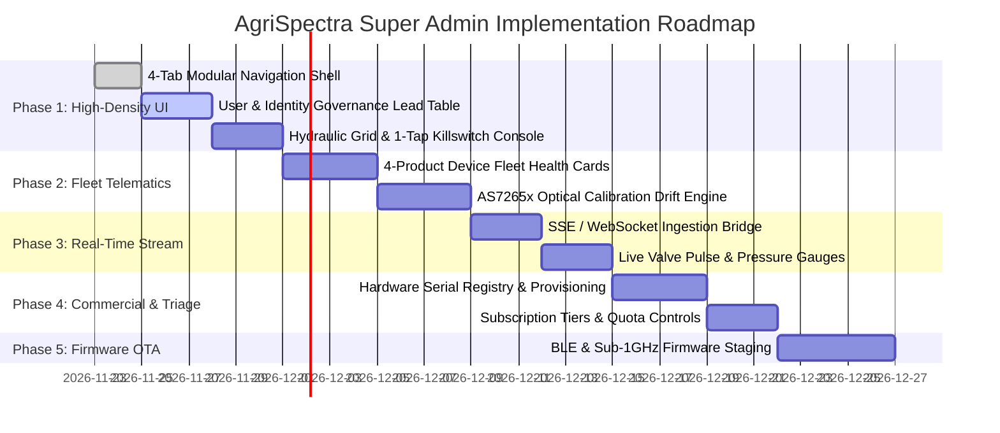
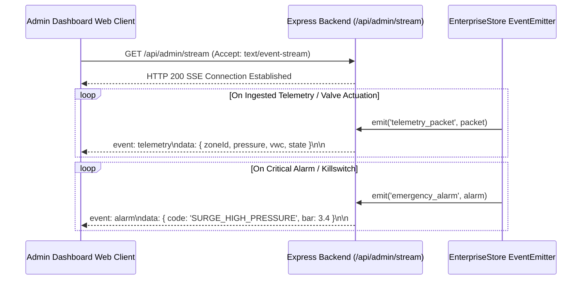

# 05. Future Implementation Roadmap & Technical Specifications

## 1. Engineering Roadmap Overview

To evolve the current admin portal into the complete enterprise Command Center envisioned during agritech research, development is structured into five sequential phases:

---

## 2. Phase 1: High-Density Four-Tab Command Console

Transform `website/landing/admin.html` into a high-density, multi-panel operational cockpit adhering strictly to **Unslop Design Principles** (deep agricultural obsidian `#0a0f0d`, muted border tones `#1e2922`, tabular numerical typography, and zero decorative fluff).

### Tab 1: Multi-Tenant Identity & RBAC Matrix
- **Data Source**: `GET /api/admin/users`, `POST /api/admin/users/role`
- **Interface Components**:
  - Searchable, filterable enterprise user table with column sorting.
  - Role badge indicators (`superadmin` [violet], `farm_owner` [emerald], `agronomist` [blue], `field_operator` [amber]).
  - Modal for safe role promotion with secondary confirmation dialog for `superadmin` assignments.
  - Multi-tenant farm assignment selector (`assignedFarms: ['farm-valley-1', 'farm-delta-2']`).
  - One-click account suspension toggle.

### Tab 2: Hardware Fleet Telematics Operations (The 4 Products)
- **Data Source**: `GET /api/platform/analytics`, `GET /api/telemetry/sync`
- **Interface Components**:
  - **AS7265x Spectroscope Fleet**:
    - Serial registry, battery voltage health, total scan count.
    - Optical drift meter (comparing dark/white calibration delta).
  - **Bi-Stable Solenoid Valve Fleet**:
    - 6-zone manifold grid displaying real-time latch state (`OPEN` / `CLOSED`).
    - Mechanical cycle counter (warning badge when cycles > 80,000).
    - Pressure gauge showing upstream mainline pressure (Bar).
  - **Multi-Depth Soil Probe Fleet**:
    - Multi-horizon moisture profiles (10cm, 20cm, 30cm) rendered as bar depth charts.
    - Bulk EC salinity alert badge (flags salt accumulation).
  - **Canopy Microclimate Stations**:
    - Aspirated fan RPM monitor.
    - Real-time Vapor Pressure Deficit (VPD) indicator with crop stress color band.

### Tab 3: Hydraulic Safety Grid & Water Accounting
- **Data Source**: `POST /api/admin/emergency-killswitch`, `/api/admin/audit-logs`
- **Interface Components**:
  - **Prominent 1-Tap Emergency Killswitch**: High-visibility red physical-style latch button with confirmation modal.
  - **Live Valve Pulse Override**: Allows authorized admins to dispatch timed 15-minute manual opening pulses or instant -12V closing pulses.
  - **Water Extraction Ledger**: Cumulative liters pumped vs. seasonal regulatory farm quotas, calculated with 24-hour variance tracking.

### Tab 4: Commercial Sales, Licensing & Agronomic Support Triage
- **Data Source**: `/api/platform/events`
- **Interface Components**:
  - **Device Inventory Registry**: Hardware MAC address, BLE UUID, manufacturing batch, and warranty activation date.
  - **Subscription Tier Manager**:
    - `Community Tier` (Free, 50 offline scans/month, 1 valve zone).
    - `Precision Farm Tier` (Standard, unlimited scans, 6 valve zones, automated ETc rules).
    - `Enterprise Agro-Corp Tier` (Multi-farm consolidation, agronomist API access, raw 18-channel spectral export).
  - **Diagnostic Support Hub**: In-app crash stack traces, BLE pairing timeout logs, and customer ticket status.

---

## 3. Phase 2: Real-Time Telemetry Streaming (SSE / WebSockets)

Currently, the admin portal polls the backend on page load. Phase 2 introduces Server-Sent Events (SSE):

---

## 4. Phase 3: Automated Optical Drift & Soil Cavitation ML

Implement client-side and backend statistical algorithms to protect data integrity:
- **AS7265x Chemometric Outlier Filter**:
  - Computes Mahalanobis distance across the 18 spectral channels against baseline crop reflectance curves (e.g., healthy nonpareil almond canopy).
  - Flags contaminated scans (dust on lens or loose leaf clamp) with an alert in the admin scan table.
- **Soil Cavitation Detector**:
  - When the 10cm sensor shows a sudden drop in dielectric permittivity while 20cm/30cm remain saturated, the system flags physical soil shrinkage or rodent burrowing around probe rods.

---

## 5. Phase 4: Over-the-Air (OTA) Firmware Management

- **Storage**: Cloud Storage bucket containing signed `.bin` firmware builds for the Nordic nRF52840 (Spectroscope) and Espressif ESP32 (Irrigation Controller).
- **Admin Control**:
  - Staged rollouts (e.g., deploy v1.4.2 to 5% of active field controllers).
  - Rollback capability in case of BLE packet drop regressions.
  - Minimum supported firmware enforcement preventing out-of-date controllers from connecting to the cloud.

---

## 6. Verification & Quality Gates

Every phase must satisfy three mandatory verification checkpoints before deployment to production:
1. **Adversarial Security Re-Verification**: Run `npm run security:audit` ensuring all 19 attack vectors remain 100% neutralized.
2. **Zero-Secret Static Scan**: Run `npm run monitor:security` verifying 0 high-entropy keys or CWE vulnerabilities across all files.
3. **CI/CD Pipeline Green Gate**: Full automated verification across GitHub Actions, Firebase Hosting deploy, and live Render backend health checks.

---

*End of Document 05.*
